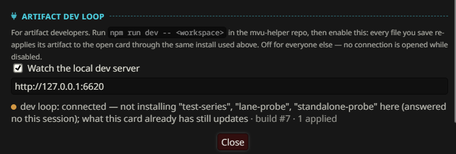

# Development Environment and Dev Loops

This is the setup I use to build games on MVU Helper. VS Code with an AI assistant, a Chrome window the AI can see, and the dev loop that sends every save straight into SillyTavern.

Set it up once, and you never export or import a pack by hand while you work. You save a file, and the game on your screen already runs the new code.

## What you need first

- **SillyTavern with MVU Helper**, plus the extensions it rides on: Tavern Helper, ST-Prompt-Template with Environmental isolation on, and MVU. See [Tavern Helper, ST-Prompt-Template and MVU](../st_extensions/README.md).
- **[Node.js](https://nodejs.org/en/download).** The dev loop runs on it, and so does the tool that lets your AI see Chrome.
- **[Git](https://git-scm.com/install/windows),** to get the template.
- **[Google Chrome](https://www.google.com/chrome/).**
- **[VS Code](https://code.visualstudio.com/download).**

## Step 1: get the template workspace

The `mvu-helper-template` branch of this repo is a complete workspace, ready to open. Clone it into a folder of your own:

```
mkdir c:\dev
cd c:\dev
git clone -b mvu-helper-template --single-branch https://github.com/KritBlade/mvu-helper.git my-game
```

No git? Open the [branch on GitHub](https://github.com/KritBlade/mvu-helper/tree/mvu-helper-template), then Code > Download ZIP.

You get this:

| File or folder | What it is |
| --- | --- |
| `workspace/` | your packs: a blank GameLogic Pack, 2 sample GameLogic Plugins, a sample StatusMenu Pack and a sample Event Pack |
| `CLAUDE.md` | the project rules for an AI coding assistant, see [Step 4](#step-4-vs-code-and-an-ai-assistant) |
| `.mcp.json` | how your AI connects to Chrome, see [Step 3](#step-3-your-ai-connects-through-mcpjson) |
| `README.md` | a short guide to the template |

What each sample in `workspace/` shows is on [The template workspace](../gamelogic_engine/install.md#the-template-workspace).

## Step 2: a Chrome window your AI can see

Your AI can read your code, but it can't see SillyTavern. It can't read the console, where MVU Helper and your engine print what happened every reply. It can't see the screen either.

Chrome's remote debugging fixes that. Start Chrome with a debugging port open, and a program on your PC can connect to it: read the console, take a screenshot, run code on the page, click a button. So your AI can play a reply and read the result itself, instead of you copying logs back and forth.

It needs its own profile, a separate folder for that Chrome's data. 2 reasons:

- **Chrome refuses it on your normal profile.** Newer versions of Chrome ignore the debugging port when it's your everyday profile.
- **It keeps your normal browsing out of it.** Anything on your PC can control a window with that port open. Your saved passwords and logins shouldn't be in it.

Make a startup script. Save this as `start-chrome-debug.bat` on your desktop:

```bat
@echo off
start "" "C:\Program Files\Google\Chrome\Application\chrome.exe" --remote-debugging-port=9222 --user-data-dir="C:\chrome-debug-profile"
```

Double-click it, and open SillyTavern in the Chrome window that comes up. The first time, it's a fresh Chrome with nothing saved. From then on, everything you do in it stays in `C:\chrome-debug-profile`.

To check it works, open `http://localhost:9222/json/version` in any browser. If you see a few lines of JSON, the port is open.

Use this Chrome for SillyTavern only. Don't log into your bank in it.

## Step 3: your AI connects through .mcp.json

The template already comes with a `.mcp.json`:

```json
{
  "mcpServers": {
    "chrome-devtools": {
      "command": "cmd",
      "args": ["/c", "npx", "-y", "chrome-devtools-mcp@latest", "--browser-url=http://localhost:9222"]
    }
  }
}
```

It adds Chrome DevTools as a tool your AI can use, pointed at the Chrome from step 2. Nothing to install by hand: `npx` downloads it the first time it runs.

So once step 1 and step 2 are done, your AI can get in. Start the Chrome first, then your AI.

Claude Code reads `.mcp.json` by itself when you open the folder, and asks you once to approve the server. Other assistants keep their tools in their own settings, so add the same server there, with the same command.

## Step 4: VS Code and an AI assistant

Download [VS Code](https://code.visualstudio.com/) and open the folder you cloned in step 1, the one that holds `CLAUDE.md`, `.mcp.json` and `workspace/`  (eg. `c:\dev\my-game`, and `workspace/` should be under this folder)  Open that folder, not `workspace/` itself, or your AI won't find the 2 files.

Then pick an AI assistant:

- **GitHub Copilot Free** works out of the box in VS Code.
- **I recommend the Claude Code extension or the Codex extension.** They let you code with the Claude Code subscription or the Codex subscription, right inside VS Code.
- **Or install the "Unify Chat Provider" extension.** It connects VS Code to the DeepSeek API, OpenRouter, OpenAI, a ChatGPT Plus subscription or a SuperGrok subscription.

The template's `CLAUDE.md` holds the guidelines I found useful when developing a game logic engine: what belongs in your workspace and what belongs to MVU Helper, how to name things, never adding a fallback without asking, and more. Claude Code reads it automatically. With another assistant, point it to the file.


## Step 5: start the dev loop

Open Windows CMD in the folder you cloned in step 1, and run:

```
cd c:\dev\my-game
npm run dev
```

The first time, it downloads MVU Helper's dev server, the same way `.mcp.json` downloads the Chrome tool. It lands in npm's own cache, not in your game's folder. That's on purpose. Your AI never sees MVU Helper's code, so it never mistakes it for something it should change to make your engine work. Then the server watches `c:\dev\my-game\workspace`.

Port 6620 taken? Run `npm run dev -- --port 6621`, and change the address in MVU Helper to match.

Then in SillyTavern: MVU Helper > GameLogic Packs tab > Artifact dev loop > check Watch the local dev server. The address is already filled in, `http://127.0.0.1:6620`. It should connect:



The status line tells you where you are. In this one:

- **connected** > MVU Helper is talking to the dev server.
- **not installing "test-series", "lane-probe", "standalone-probe" here (answered no this session)** > the workspace has 3 packs this card doesn't have, and I said no when the loop asked to install them here.
- **what this card already has still updates** > the packs already on this card still get every save.
- **build #7 · 1 applied** > the dev server rebuilt 7 times, and the last build put 1 pack onto the card.

## What the dev loop does

Basically, whatever you change in VS Code is sent to MVU Helper the moment you save, and your game logic is updated right away. No export, no import, no reload.

Without it, every change is: export the pack, import it, install it, reload the chat. That's fine once a day. It's painful 50 times an hour. 

How it works:

1. **`npm run dev` starts a small server on your PC.** It only listens on your own machine, `127.0.0.1`, port 6620. It watches your workspace folder.
2. **Every time you save, it rebuilds your packs,** and runs the same checks an import runs. A pack with errors is skipped, and the error is shown.
3. **MVU Helper, with the checkbox on, listens to that server.** Each rebuild, it installs the changed pack onto the open card, through the same install the Install to this card button uses.

What a save changes on the card:

- an `engine/` save rewrites and reloads the engine,
- an `entries/` or `panel/` save rewrites the entries,
- a `schema/` or `regex/` save rewrites those,
- a `pack.json` save rewrites everything.

It's built to be safe to leave on:

- **It asks before installing anything new on a card.** The first time it applies to a card that doesn't have one of your packs yet, it asks once whether this is a dev card. Yes, and it installs the whole workspace there on every save. No, and it only updates what the card already has. The new packs still land in your Pack library, one Install click away.  I usually choose "No" so that I can handpick which pack I want to install to the character card.  It will still auto sync whatever that is installed anyway.
- **The answer lasts until you restart the dev server.** Restarting it is how you get asked again.
- **It never uninstalls anything,** and it does nothing in the lobby. It waits until a chat is open.
- **It's off for everyone else.** With the checkbox off, MVU Helper opens no connection at all.

A plugin needs one install by hand first, because the loop never picks your LLM calls for you. See [Build, install and uninstall](../gamelogic_plugin/install.md#develop-against-a-live-card).

## Check your work: npm test

The template also comes with checks to run before you call a change done. Open CMD in `c:\dev\my-game` and run:

```
npm test
```

Today it runs one check, the EJS scope scan. It reads every entry in `workspace/`, the GameLogic Pack's and every plugin's, and fails when 2 entries that render together declare the same top-level name. That mistake breaks the whole prompt without a single error on screen, so it's worth catching before it reaches your chat. Why it happens is on [EJS in your entries](../gamelogic_plugin/entries.md#ejs-in-your-entries).

Your AI can run it too, and the template's `CLAUDE.md` tells it to. As your game grows, add your own checks to `tools/`, and list them in the `test` script in `package.json`.

## The whole loop

Put all of this together, and your AI can work on its own:

1. You, or your AI, change the engine in VS Code and save.
2. The dev loop installs it on the open card, in a second.
3. Your AI runs `npm test`, and fixes what it finds.
4. A reply is played in SillyTavern.
5. Whenever you have errors want to show to AI, just ask AI in VS code chat and have him to get into chrome via MCP.
6. Back to 1.

That's the setup. Your editor, your game and your AI all look at the same thing, at the same time.  AI could code and see what's going on in Chrome as he code.

## Security

With this setup, you run a lot of engine code you didn't read line by line. Your AI writes it, and the dev loop installs it the moment it's saved. That's fine, because the game logic engine is heavily locked down.

Your engine runs in its own sandbox, away from the SillyTavern page. It can only read and write 2 things: the game chat and the game's MVU variables. No network, no files, no SillyTavern settings, no other card.

So the worst programmer, or the worst AI, can only get the game logic wrong. Wrong damage, a wrong affection score, an event that fires at the wrong time. It can never read or write anything outside the chat, and it can't crash SillyTavern either. If the engine throws, MVU Helper logs it, and that one reply just isn't resolved. If it hangs while loading, it's cut off after 10 seconds.

That lockdown is about the engine code. Your AI assistant itself runs on your PC and controls the debug Chrome, so the advice in [Step 2](#step-2-a-chrome-window-your-ai-can-see) still stands.

The full story, what's blocked and why, is in the Security point of the [README](../../README.md#why-build-on-top-of-mvu-helper-instead-of-coding-my-own-extension).

[Back to index](../../README.md)
