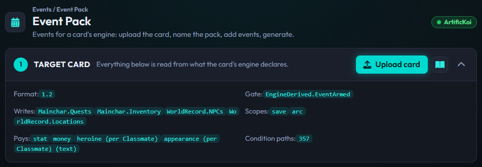
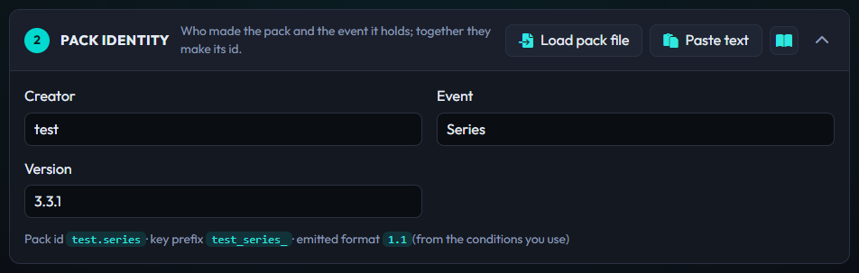
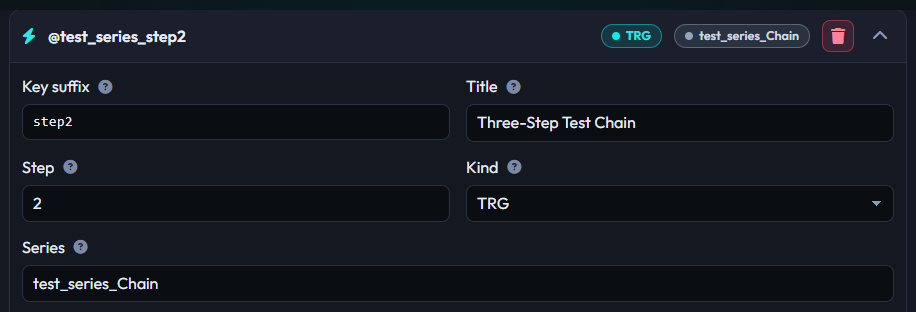
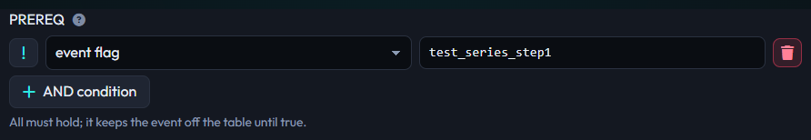
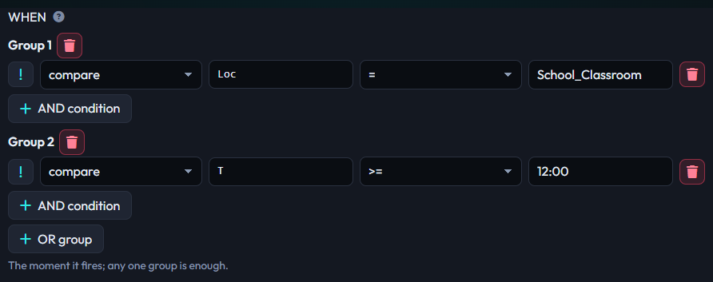
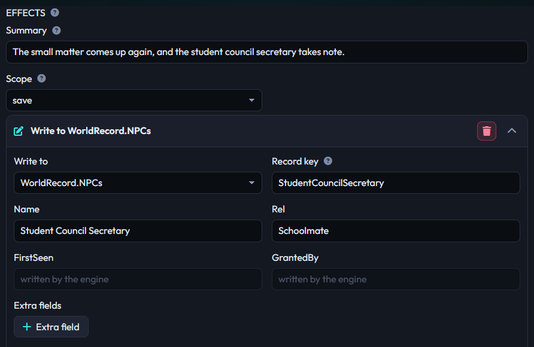
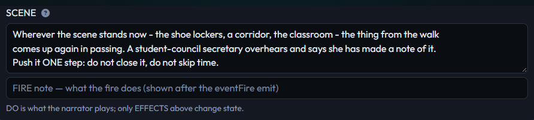

# Build events in MVU Status Menu Builder

> This page applies to any game. ArtificKoi shows up as a real example, not as a rule. See [Written for any game](technical.md#written-for-any-game).

MVU Status Menu Builder has an **Event Pack** tab where you build a pack by clicking. You never write JSON, EJS or a key prefix. The builder writes all of it, and MVU Helper checks the result again before anything touches a card.

You start by uploading the game card. From then on, the builder only offers what that game allows: its conditions, the paths it opens and the fields its schema has.

It's like ordering at a kiosk instead of shouting at the kitchen. The kiosk only shows what the kitchen can actually make.

The tab has 4 numbered cards, and you go through them top to bottom. Each card has a link to its guide, and each field has a **More detail** link.

## What you need first

The game card as a file, `.json` or `.png`, exported from SillyTavern with its engine installed. The builder reads 3 things from it:

- **the engine,** found by its `[MVU_LogicEngine]` entry. The builder runs it, and reads `EVENT_PACK_ADAPTER` and `EVENT_PACK_FORMAT` off it.
- **the Zod schema,** which says which fields exist at each path a pack may write.
- **the starting variables** in `[InitVar]`, which give the path picker real paths and the cast's keys.

A card whose engine declares no `EVENT_PACK_ADAPTER` is refused. Nothing can be built for a game that opened no doors.

## 1 · Target card

Click **Upload card**, and pick the `.json` or `.png`. When it reads, the card's name shows at the top of the page, and the card lists what the game declares:

| Line | Means |
| --- | --- |
| **Format** | the pack format the game's engine runs, like `1.2` |
| **Gate** | the armed pointer every scene body is gated on, like `EngineDerived.EventArmed` |
| **Writes** | the paths a pack may write, like `Mainchar.Quests` `Mainchar.Inventory` `WorldRecord.NPCs` `WorldRecord.Locations` |
| **Scopes** | the `scope` values the game knows, like `save` `arc` |
| **Pays** | the reward kinds the game pays, like `stat` `money` `heroine (per Classmate)` `appearance (per Classmate) (text)` |
| **Condition paths** | how many paths the condition picker offers |

If a line says `none declared`, the game doesn't offer that. No writes means events can only play scenes and fire. No scopes means the Scope box is free text.

## 2 · Pack identity

| Box | Example | What it does |
| --- | --- | --- |
| Creator | `paulK` | your name. It may not contain `official` |
| Event | `Beach Arc` | the pack's name |
| Version | `1.0` | your revision. Bump it every time you change the pack |

The line under them shows what you get:

- **pack id** `paulk.beach_arc`, the identity MVU Helper upgrades by,
- **trigger key prefix** `paulk_beach_arc_`, which goes in front of every event's key,
- **emitted format**, worked out from what you actually use. A reward makes it `1.1`.

If your pack needs a newer format than the game's engine runs, a red line says so. That pack can't run on that card.

Put at least one latin word in Creator and Event. A name written only in Chinese turns into nothing in the prefix, and is refused.

**Editing an existing pack:** **Load pack file** reads any pack back into the GUI, or **Paste text** and then **Load pasted pack** does the same from pasted text, including one you generated earlier. Bump the Version before you install the edit.

## 3 · Events

Click **Add event** for each event. One pack is one series, up to 20 events.

### The event's own fields

| Box | Example | What it does |
| --- | --- | --- |
| Key suffix | `invite` | the event's id in your pack. The full key is prefix + suffix: `paulk_beach_arc_invite`. Lowercase, digits and `_` |
| Title | `Beach Invite` | the scene's header line. For reading only |
| Step | `1` | shows as `·1` after the title. For reading only |
| Kind | `TRG` | `TRG` for nearly everything. `TIME` for a beat tied to the clock or the calendar. When 2 events are ready at once, `TIME` wins |
| Series | `Beach Arc` | the arc's name, the same on every event of the pack |

**Adding a second event to a series fills in the chain for you.** It copies the Series, and puts an **event flag** on the previous event into PREREQ. So step 2 waits for step 1 to fire.

### PREREQ: is it on the table

All conditions here must hold. AND only. **AND condition** adds one.

Put durable story state here: an earlier event fired, a quest reached a step. Step 1 of a series usually has no PREREQ at all.

### WHEN: is this the moment

All conditions in a group must hold. **AND condition** adds one to the group. **OR group** adds another group, and then any one group is enough.

Put the moment here: the time, the place, who's in the scene. The engine can tell the story which single WHEN condition is still missing, so it can steer toward it. Put the moment in PREREQ, and it can't. See [prereq vs when](file.md#prereq-vs-when).

### One condition

Each condition is one row:

- the **`!`** box, which flips it to NOT,
- the **kind**,
- the boxes that kind needs,
- **×** to remove it.

| Kind | Boxes | Example |
| --- | --- | --- |
| compare | variable path, operator, value | `T` `>=` `16:00` |
| in set | variable path, values with commas | `Mood` in `Happy, Excited` |
| Present(name) | the character's key | `Mitsuki` |
| event flag | the event's full key | `paulk_beach_arc_invite` |
| contains text | variable path, text | `Classmate.*.Mood` contains `Excited` |
| has element | collection path, element | `Mainchar.Inventory` has `camera` |

What each kind means, exactly, is on [The condition language](dsl.md).

**The path box suggests, it doesn't fence.** It offers the game's shortcuts, each with the path it stands for (`Aff(*)` is `Classmate.*.Affection`), `DaysSince(*)`, and every path the schema declares. A `*` in a suggestion is the part you fill in: `Aff(*)` becomes `Aff(Mitsuki)`.

**A path the card doesn't declare shows a warning,** never a block. It tells you to check the spelling, or to ignore it if your own pack creates that path. Take it seriously. A misspelled path passes every check, and the event simply never fires.

**Present() takes the key,** not the display name. `Present(Mitsuki)` works. `Present(Mitsuki Tachibana)` never fires. The box suggests the cast's keys, and fixes the case when it knows the key: type `MiTSUki`, and it snaps to `Mitsuki`.

**The builder refuses a value it can't spell,** like an `&` or a stray `>` typed into a box. That's the grammar protecting your pack. Reword the value.

### EFFECTS: what the engine commits

- **Summary.** One line naming what this event does. It's a label for you and for the pack list. Nothing writes it into the save.
- **Scope.** The values the game declares, or **(card default)**. On ArtificKoi, `save` fires once ever, and `arc` can fire again after the story loops. See [scope](file.md#scope-save-or-arc).

**Add write** adds a write:

- **Write to** lists the paths the game opens.
- **Record key** shows for a collection: the record you're writing. Type the name the player reads, like `Ruinblade` or `Beach_Day`. Nothing is put in front of it. On a shared registry, like the NPC and location books, type the key the world already uses, like `School_Cafeteria`.
- **Remove this record** is a switch, and shows only on a path the game marks removable.
- **The fields** come from the game's schema. A number field takes a number, a true/false field is a dropdown, and a `[value, label]` field is written as a pair for you. Greyed fields are written by the engine. Fields the game locks don't show at all.
- **Set or add** is a toggle on each field the game lets you add to.
- **Extra field** shows on a record with open fields, or a path the schema doesn't describe.

**Add reward** adds a payout. It's greyed out when the game pays nothing.

- **Reward** is the kind, like `money` or `heroine`.
- **To** shows for a kind paid to one member: name who, like `Mitsuki`. Or pick a selector like `Classmate.*.Is_present`, and the engine pays whoever that field marks.
- **Field** and **Amount**. A text kind asks for **New text** instead.

The hint next to it says the most one event can pay. Go over, and a warning says the engine will pay the ceiling instead. Everything about writes and rewards is on [Writes and rewards](writes.md).

### SCENE: what the narrator plays

Scene is the actual prose to tell AI model what to do in this event.

- **DO.** What the narrator plays when the event is armed. A short, concrete slice: who does what, in a sentence or 2. Say what must NOT happen, too: no skipping time, no new characters.
- **FIRE note.** One line on what the fire commits, like "opens the Beach Day quest". It's shown to the narrator after the report it has to make.

The scene changes no state. An event that should make her like you more plays a moment that earns it, and pays it in EFFECTS.

## 4 · Pack text

Click **Generate**. If anything can't be built, the error names it: an empty key suffix, a duplicate key, a condition the grammar can't spell.

Then take it out:

- **Copy**, to paste into MVU Helper's Event Packs tab.
- **Download .txt**, the same text as a file. That's the file you share.
- **Download artifact .zip**, the same text as an artifact folder for the dev loop, see [Develop it with the dev loop](install.md#develop-it-with-the-dev-loop).

The text is the one on [The event pack file](file.md). You never have to edit it.

## Install and test it

1. MVU Helper > Event Packs > paste it or Load file > **Validate** > **Add & install**. MVU Helper checks everything again, on its own, so a builder bug is caught here instead of showing up as a dead event.
2. Play, and watch the log:
   - `EVENT ARMED -> @paulk_beach_arc_invite`: the conditions hold, and the scene goes to the narrator.
   - `EVENT FIRED: paulk_beach_arc_invite`: the narrator played it, and the effects landed.
   - `EVENT FIRE REJECTED (verify-at-fire...)`: the narrator said it fired, and the state didn't back it. Working as designed.
3. A fired event shows up in `stat_data.EventPack.fired.<key>`, with `state: "done"`.

**Testing a NOT condition? Add a canary.** That's a throwaway event whose condition must never hold, with a summary that screams if it fires. A canary that never fires proves nothing, until you've also seen it fire once by making its condition true on purpose.

## Common mistakes

| Mistake | What happens | Fix |
| --- | --- | --- |
| `in set` on a collection, like `Classmate` | never true | use `has element` |
| the moment in PREREQ | the event fires, but the "one condition away" steering never sees it | durable state in PREREQ, the moment in WHEN |
| chaining on a quest's Step | the chain freezes once the quest is deleted | chain on an event flag |
| a scope typo, like `Save` | quietly acts like `arc`, and fires again after the loop | pick it from the Scope list |
| expecting DO to change stats | nothing moves. The scene is not an effect | use a write or a reward |
| 2 arcs in one pack | refused at install | one pack per arc |
| editing without bumping Version | refused: "already installed" | bump Version on every edit |
| an empty or non-latin key suffix | refused at Generate, by name | a short latin suffix per event |

[Back to How the EventPack Engine works](technical.md) · [Back to index](../../README.md)
