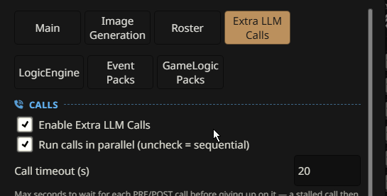
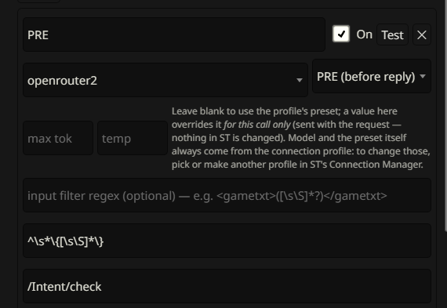

# Extra LLM Calls

SillyTavern makes 1 LLM call per reply, on the one connection profile you picked in Connection Manager. Extra LLM Calls lets a card make more: any number of calls BEFORE the main reply, and any number AFTER it. Each one can run on its own connection profile.

The calls before the reply are called PRE. The calls after it are called POST.

PRE > narrate > POST.

## Why more than 1 call

Your main model is the expensive one, and it's good at one thing: the prose. A game card asks for a lot more than prose. Somebody has to judge whether your action worked, keep track of who's in the scene, and write down what changed after every reply.

Pile all of that on the main model, and it gets slower, more expensive, and worse at the prose. So a card built for MVU Helper hands those small jobs to extra calls, on a cheap, fast model.

Think of a film set. The director only directs. The script supervisor checks continuity before each take, and the editor logs what was shot after it. Nobody pays the director to take notes.

## What you need to do

Almost nothing. A card built for Extra LLM Calls brings its calls with it: their names, when they run and what they read. The only thing the card can't bring is which model runs each call, because that's your connection, not the card's.

So you pick one connection profile per call:

1. Load the card and open a chat.
2. Open MVU Helper > **Extra LLM Calls**.
3. Make sure **Enable Extra LLM Calls** is on.
4. For each call in the **Call list**, pick a connection profile in its **Connection** dropdown.

That's it. A call that's on but has no profile shows a **No connection** pill on its card, and MVU Helper tells you with a toast too.

**Make the profiles in SillyTavern's Connection Manager first**. One profile is one model plus its preset. A different preset is a different profile.

## Which model for which call

PRE and POST calls do small, focused jobs, so a cheap, fast model is usually fine. The card's author may suggest one.

- **PRE holds up your reply.** The narrator waits until every PRE call is back. A slow PRE model means a slow reply.
- **POST doesn't hold anything up.** It runs after the reply is already on screen.
- **2 calls can share one profile.** They just take turns instead of running at the same time, so a local server with one slot never chokes.

## The settings

At the top of the tab, in the **Calls** card:

| Setting | What it does |
| --- | --- |
| **Enable Extra LLM Calls** | the master switch. Off, and no PRE or POST call runs. The pill at the top of the tab follows it: **Calls on** or **Calls off**, and hides with no chat open |
| **Run calls in parallel** | on, and the calls of one phase run at the same time, except calls sharing a profile, which take turns. Off, and they run one after another |
| **Call timeout (s)** | how long to wait for each call before giving up on it, 60 seconds by default. A stuck call counts as empty, and the reply goes on without it |

Each call is a card of its own in the **Call list**:

| Field | What it does |
| --- | --- |
| the switch, left of the name | turns this one call on or off, without deleting it |
| the play button | **Run this call now**: runs the call right away, and shows the answer in a toast |
| **Connection** | the model this call runs on. Yours to pick |

The rest of each call's fields belong to the card, **Max tokens** and **Temperature** included. Blank means the profile's preset decides. You can change them, but a card upgrade puts the card's values back. All these settings are per card, so every card keeps its own calls.

## How to use it

A call has no prompt box. Its prompt is a lorebook entry.

So make a new entry in your card's lorebook, and put the call's name in brackets in its comment, like `[PRE] Weather Forecast`. That's the name you gave the call in the **Call list**. Every lorebook entry with that tag is sent out with the call: before the reply for a PRE call, after it for a POST call.

You can disable the entry in SillyTavern, so the main LLM call never reads it. MVU Helper still reads it, as long as the tag is there. So the rules meant for PRE stay out of your expensive model's prompt.

More on how these entries are put together is on [What a call reads](prompts.md).

## What you'll see

Most of the time, nothing. PRE's output goes into the prompt the narrator reads, and never shows up in the chat. POST writes what it recorded into the reply as a `<POSTUpdateVariable>` block. Many cards hide it with a regex.

When something goes wrong, MVU Helper tells you:

- **PRE degraded**: a PRE call returned nothing usable, or timed out. The reply is written without it.
- **POST slow**: the POST calls are taking a long time. If they don't finish in time, the reply's last touches, like the stat box, are written without them.
- **a No connection pill on a call**: the call is on, but has no connection profile.

## Swipe, regenerate and delete just work

PRE, the narrator and POST all have to agree on which reply they're talking about. That's harder than it sounds, because you can swipe, regenerate, stop or delete at any moment, even while a call is still running.

MVU Helper handles all of it. A regenerate never builds on the attempt you threw away. A swipe gets its own PRE, its own reply and its own POST. Stop a reply halfway, and POST doesn't record the half reply. Delete a reply while POST is still running, and POST writes nothing into the wrong message.

Continue, impersonate and SillyTavern's own background calls aren't new turns, so no extra call runs for them.

## For card authors

How to set up calls for your own card, what each call reads and where its answer goes, is on [How Extra LLM Calls work](technical.md).

Basically, your main model writes the story, and the extra calls do the small jobs around it, each on the model you picked for it.

[Back to index](../../README.md)
