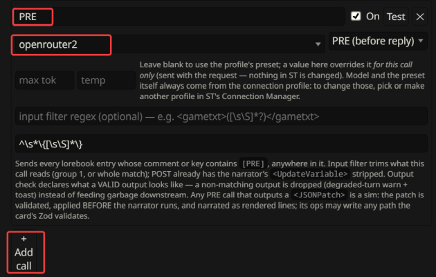
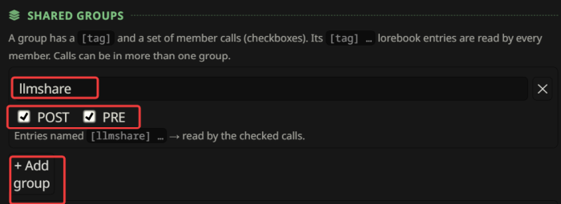

# Set up the calls

> This page applies to any card. ArtificKoi shows up as a real example, not as a rule.

Every PRE and POST call is set up in MVU Helper > **Extra LLM Calls**. The setup is per card: each card keeps its own calls, and switching cards switches the list.

A call needs a name, a phase and a connection profile. Its prompt doesn't live here at all. It lives in the lorebook, see [What a call reads](prompts.md).

## Add a call

Click **+ Add call**. It asks for 2 things:

- **Call name.** The prefix of the lorebook entries this call reads. A call named `PRE2` reads every entry tagged `[PRE2]`.
- **Phase.** PRE, before the reply is written, or POST, after it.

The name has 3 rules, and each one is there for routing:

- **it can't be empty.** An unnamed call is routed no entries, and quietly does nothing.
- **no `[` or `]`.** MVU Helper adds the brackets itself when it looks for the entries.
- **unique, whatever the case.** 2 calls named `pre` and `PRE` would both claim the same entries.

## The settings at the top

| Setting | Default | What it does |
| --- | --- | --- |
| **Enable Extra LLM Calls** | on | the master switch. Off, and no PRE or POST call runs. Your engine's `preAssemblyPatch` still runs |
| **Run calls in parallel** | on | on, and all calls of a phase run at the same time, except calls on the same connection profile, which take turns. Off, and they run one after another, in list order |
| **Call timeout (s)** | 60 | the longest MVU Helper waits for each call. A stuck call counts as empty, and the others go on. 5 to 600 |

Why calls on one profile take turns: one profile is one endpoint. A local server with one slot chokes when 3 requests land on it at once. Different profiles still run side by side.

## Each call's fields

| Field | What it does |
| --- | --- |
| name | the `[name]` this call reads, and the name groups list it by. It logs under `[small-llm] [<name>]` |
| **On** | turns this one call on or off, without deleting it |
| **Test** | runs the call right now against your last message, and shows the answer in a toast |
| **✕** | deletes the call |
| connection profile | the model the call runs on. Each player picks their own, it never travels with the card |
| phase | **PRE (before reply)** or **POST (after reply)** |
| **max tok** | the most tokens this call may answer with. Blank uses the profile's preset |
| **temp** | the temperature for this call. Blank uses the profile's preset |
| input filter regex | narrows what the call reads. With a capture group, the call reads group 1, otherwise the whole match. `<gametxt>([\s\S]*?)</gametxt>` sends only that slice |
| output check regex | what a valid answer looks like. Prose that doesn't match is dropped, with a toast, instead of being passed on. Patch blocks are split out first, so they always survive |

**There's no per-call preset, on purpose.** SillyTavern puts the preset inside the connection profile. So a different preset is a different profile: make one in Connection Manager, and pick it. MVU Helper never changes SillyTavern's own profiles. **max tok** and **temp** only ride along with the request.

## When a call actually runs

All of these, every time:

- **Enable Extra LLM Calls** is ticked,
- the call has a name and is **On**,
- it has a connection profile,
- at least one lorebook entry is tagged for it.

A call with nothing tagged for it is skipped, and costs no request.

MVU Helper says when a call won't run while entries are tagged for it. On chat load, and after any change in the tab, the console names that call and its entries. A call that's **On** with no profile also shows a warning next to its name, and a toast, because it was meant to run.

## Shared groups

Some content is the same for several calls: a cast roster, your schema's syntax. Copying it into every call's entries means editing it in 3 places, and drifting.

A shared group fixes that. It has a tag, and a set of member calls:

1. Click **+ Add group**, and type the tag, like `llmshare`.
2. Tick the calls that should read it.
3. Tag the shared entries with it: `[llmshare] Classmate_Roster`.

Every member gets the group's entries, ahead of its own `[name]` entries. A call can be in more than one group. With several, it gets every one of them.

ArtificKoi's group `llmshare` has 2 members, `PRE` and `POST`. It carries the cast roster and the schema once. `[PRE]` entries carry the classify rules, `[POST]` entries the record rules, and the narrator's voice stays in untagged entries.

## What travels with your card

You don't want every player to set up your calls by hand. So your card carries its setup:

1. Set up your calls and groups.
2. Main tab > Card config > **Export config → card**. It writes the setup into a `[Initmvuhelper]` lorebook entry, the same idea as MVU's `[InitVar]`.
3. Ship the card. A player who loads it gets your calls the first time they open a chat.

Not everything travels the same way:

| Kind | Extra LLM Calls fields | First load | A card upgrade |
| --- | --- | --- | --- |
| the card's | each call's phase, max tok, temp, input and output regex, and each group's members | from the card | refreshed from the card |
| the player's | **Enable**, **Run calls in parallel**, **Call timeout**, and each call's **On** | from the card | kept as the player set them |
| never travels | each call's connection profile | never | never |

The card carries which calls exist and what they read. It never carries which server runs them. That's always the player's.

Every chat load compares the card's `[Initmvuhelper]` with what this card last imported. A changed entry, from a card or pack upgrade, is imported again. An unchanged one is left alone, so a field you changed in the tab stays changed until the card's setup changes.

2 more buttons, next to the export:

- **Re-import from card** imports it again now. Calls the card has and you don't come back, the card's fields are refreshed, and your connections and preferences are kept.
- **Reset from card** forgets this card's setup, and installs the card's again, preferences included.

[Back to How Extra LLM Calls work](technical.md) · [Back to index](../../README.md)
