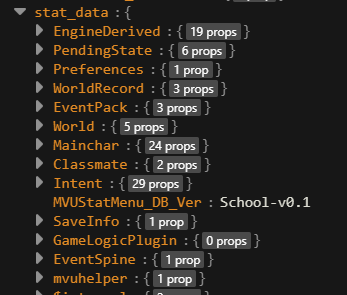

# Schema

> This page applies to any game. ArtificKoi shows up as a real example, not as a rule. See [A general design, with one real example](technical.md#a-general-design-with-one-real-example).

The schema is your Zod schema. It decides what can go into each variable, like refusing a word where your formula expects a number. What Zod does is on [Tavern Helper, ST-Prompt-Template and MVU](../st_extensions/README.md#mvu).

The install puts it on the card as a Tavern Helper script named `Scheme`. The schema [MVU Status Menu Builder](../statusmenu_builder/README.md) generates is exactly what this page asks for, so if you use the builder, you're already done.

## What the schema defines

The schema is the list of every variable your game uses. MVU keeps all of them in one variable, `stat_data`, and the schema says what goes in it: which groups there are, and what each group holds.

Think of it as the floor plan of a house. It says which rooms there are and what belongs in each one. The furniture moves around every reply. The rooms stay where the plan put them.

Here's ArtificKoi's `stat_data`, as a variable viewer shows it. Each line is one top-level group, a root, and the number is how many values it holds right now:



Your game names its roots however it wants. What matters is that each root has one job. A useful way to split them, with ArtificKoi's roots as they fall. (The following is just a format I found effective. You can change the structure to whatever you want.)

**The world and its people.** What the story is about.

| Root | What it holds |
| --- | --- |
| `World` | where and when the scene is: date, weekday, time, location and weather. `clock@1` and `location@1` point here. |
| `Mainchar` | the player's character: name, age, stats, energy, money, quests, skills and belongings. `player@1` points here. |
| `Classmate` | the cast, one entry per heroine. It grows as the story meets new people, so 2 here means 2 met so far. `cast@1` points here. |
| `WorldRecord` | what the story added during play: places found, past events and new NPCs. `landmarks@1` and `chronicle@1` point here. |

**The engine's working state.** Values the engine uses to run the game. The player doesn't look at these.

| Root | What it holds |
| --- | --- |
| `Intent` | the narrator's report channels, like `/Intent/money`. The engine reads them and clears them every reply. See [How a GameLogic Engine works](technical.md). |
| `PendingState` | hand-offs inside one turn: one part sets a value, and another part uses it and clears it. |
| `EngineDerived` | values the engine works out from everything else: today's label, the mode, the grade. The narrator never writes these. |
| `EventSpine` | the main story's own record of which story days have played. |

**Settings and housekeeping.**

| Root | What it holds |
| --- | --- |
| `Preferences` | the player's settings, like the display language. |
| `SaveInfo` | facts about the save itself, like whether the game has started. |
| `MVUStatMenu_DB_Ver` | a version stamp the status menu uses, so it knows which save upgrades it already ran. |

**Roots MVU Helper and other packs use.** These names are fixed. Keep them as they are.

| Root | What it holds |
| --- | --- |
| `GameLogicPlugin` | one drawer per installed plugin. 0 here means no plugin is installed. Declare it open, or leave it out. See [Keep the root open](#keep-the-root-open). |
| `mvuhelper` | MVU Helper's own data, like what each character is wearing, so the next picture draws the same clothes. See [Auto Image Generation](../image_gen/README.md). |
| `EventPack` | the events from installed Event Packs, and which ones have fired. See [What is EventPack Engine](../eventpack_engine/README.md). |

Watch out for this one. With a closed root, any root you don't declare is stripped on the next save, these 3 included. A closed root has to declare `mvuhelper` and `EventPack` itself, or MVU Helper's outfit memory and every Event Pack lose their data. With an open root, they just survive. Another reason to keep it open.

## Where to find it

Open Tavern Helper, go to the Script tab, and look under 角色脚本 (Character scripts, "bound to the current character card"). That's where `Scheme` lives, because it belongs to this card only. Switch to another card and you see that card's `Scheme` instead.


The pencil icon opens the script so you can read it. Don't edit it there, though. Change the `schema/` file in your pack instead. Otherwise the next install, or the next dev loop save, puts your pack's version back over your edit.

`mvu` itself sits under 全局脚本 (Global scripts), because MVU runs for every card.

## It can only declare a schema

Tavern Helper runs the `Scheme` script right on the SillyTavern page, with no sandbox. So before a schema is checked or installed, MVU Helper cuts it down to an allowlist.

What's kept, statement by statement:

- the mvu_zod import, once:
  `import { registerMvuSchema } from 'https://testingcf.jsdelivr.net/gh/StageDog/tavern_resource/dist/util/mvu_zod.js'`
- `const`, `let` and `var` declarations (`export` is fine) whose values are built only from `z.<member>(…)` calls, strings, numbers, `true`, `false`, `null`, `[…]` and `{ key: value }`, and names declared earlier in the file. The members are `string number boolean null any object looseObject tuple union array record coerce passthrough catchall prefault`.
- one `registerMvuSchema(…)` call, on its own or as `$(() => { registerMvuSchema(…); })`.
- comments.

Anything else is removed, the whole statement, along with every statement that uses a name it declared. The rest installs. A comment or string holding `</script`, `<script`, `<!--` or `-->` is removed too. Every removal is listed in the import report and the install log, and a toast names the lines.

Think of airport security. Your bag goes through, anything not on the allowed list gets taken out, and the rest of your bag still flies.

A schema that passes, in ArtificKoi's style. The `[value, label]` pairs are ArtificKoi's choice. A schema with plain values, like `Money: z.number()`, passes just the same.

```js
import { registerMvuSchema } from 'https://testingcf.jsdelivr.net/gh/StageDog/tavern_resource/dist/util/mvu_zod.js';

// ArtificKoi keeps each value with its description: [value, label]
const labeledNum = z.tuple([z.number(), z.string()]).prefault([0, '']);

export const StatDataSchema = z.looseObject({
    Mainchar: z.looseObject({ Money: labeledNum }),
    GameLogicPlugin: z.record(z.string(), z.any()).prefault({}),
});

$(() => { registerMvuSchema(StatDataSchema); });
```

## Keep the root open

Your pack is not the only one writing to the card. MVU Helper keeps a `GameLogicPlugin` root, and plugins put their own keys inside it.

A closed root, `z.object({ … })`, strips every root it doesn't name. It's like a guest list at the door. A plugin that shows up later isn't on the list, so it gets turned away, and its state is gone on the next save.

So keep the root open: `z.looseObject({ … })`, or add `.passthrough()` or `.catchall(z.any())` to it.

A closed root is refused. The one exception is a schema that also declares `GameLogicPlugin` open. That installs with a warning, because any other root added later is still lost.

## Declare GameLogicPlugin open, or leave it out

If you declare `GameLogicPlugin`, keep it open: `z.record(z.string(), z.any())`, `z.looseObject(…)`, or a form with `.passthrough()` or `.catchall(z.any())`.

A closed `GameLogicPlugin` is refused. It would strip every plugin's state on the next write.

## Watch out for stripped fields

Inside a closed object, a field you didn't declare is stripped the moment MVU saves. When you add a new value to `stat_data`, add it to the schema first.

[Back to How a GameLogic Engine works](technical.md) · [Back to index](../../README.md)
