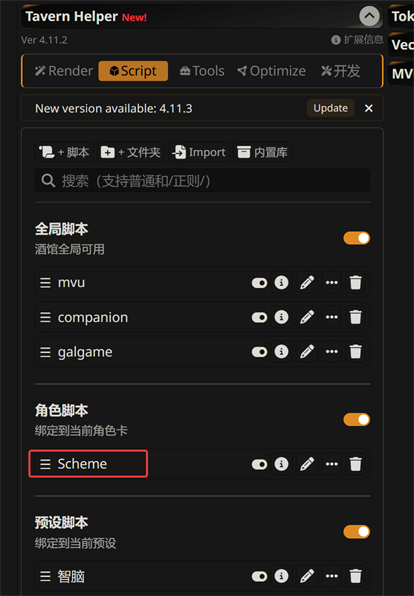

# Schema

The schema is your Zod schema. It decides what can go into each variable, like refusing a word where your formula expects a number. What Zod does is on [Tavern Helper, ST-Prompt-Template and MVU](../st_extensions/README.md#mvu).

The install puts it on the card as a Tavern Helper script named `Scheme`. The schema [MVU Status Menu Builder](../statusmenu_builder/README.md) generates is exactly what this page asks for, so if you use the builder, you're already done.

## Where to find it

Open Tavern Helper, go to the Script tab, and look under 角色脚本 (Character scripts, "bound to the current character card"). That's where `Scheme` lives, because it belongs to this card only. Switch to another card and you see that card's `Scheme` instead.



The pencil icon opens the script so you can read it. Don't edit it there, though. Change the `schema/` file in your pack instead. Otherwise the next install, or the next dev loop save, puts your pack's version back over your edit.

`mvu` itself sits under 全局脚本 (Global scripts), because MVU runs for every card.

## It can only declare a schema

Tavern Helper runs the `Scheme` script right on the SillyTavern page, with no sandbox. So before a schema is checked or installed, MVU Helper cuts it down to an allowlist.

What's kept, statement by statement:

- the mvu_zod import, once:
  `import { registerMvuSchema } from 'https://testingcf.jsdelivr.net/gh/StageDog/tavern_resource/dist/util/mvu_zod.js'`
- `const`, `let` and `var` declarations (`export` is fine) whose values are built only from `z.<member>(…)` calls, strings, numbers, `true`, `false`, `null`, `[…]` and `{ key: value }`, and names declared earlier in the file. The members are `string number boolean null any object looseObject tuple union array record coerce passthrough catchall prefault`.
- one `registerMvuSchema(…)` call, on its own or as `$(() => { registerMvuSchema(…); })`.
- comments.

Anything else is removed, the whole statement, along with every statement that uses a name it declared. The rest installs. A comment or string holding `</script`, `<script`, `<!--` or `-->` is removed too. Every removal is listed in the import report and the install log, and a toast names the lines.

Think of airport security. Your bag goes through, anything not on the allowed list gets taken out, and the rest of your bag still flies.

A schema that passes, in ArtificKoi's style:

```js
import { registerMvuSchema } from 'https://testingcf.jsdelivr.net/gh/StageDog/tavern_resource/dist/util/mvu_zod.js';

// ArtificKoi keeps each value with its description: [value, label]
const labeledNum = z.tuple([z.number(), z.string()]).prefault([0, '']);

export const StatDataSchema = z.looseObject({
    Mainchar: z.looseObject({ Money: labeledNum }),
    GameLogicPlugin: z.record(z.string(), z.any()).prefault({}),
});

$(() => { registerMvuSchema(StatDataSchema); });
```

## Keep the root open

Your pack is not the only one writing to the card. MVU Helper keeps a `GameLogicPlugin` root, and plugins put their own keys inside it.

A closed root, `z.object({ … })`, strips every root it doesn't name. It's like a guest list at the door. A plugin that shows up later isn't on the list, so it gets turned away, and its state is gone on the next save.

So keep the root open: `z.looseObject({ … })`, or add `.passthrough()` or `.catchall(z.any())` to it.

A closed root is refused. The one exception is a schema that also declares `GameLogicPlugin` open. That installs with a warning, because any other root added later is still lost.

## Declare GameLogicPlugin open, or leave it out

If you declare `GameLogicPlugin`, keep it open: `z.record(z.string(), z.any())`, `z.looseObject(…)`, or a form with `.passthrough()` or `.catchall(z.any())`.

A closed `GameLogicPlugin` is refused. It would strip every plugin's state on the next write.

## Watch out for stripped fields

Inside a closed object, a field you didn't declare is stripped the moment MVU saves. When you add a new value to `stat_data`, add it to the schema first.

[Back to How a GameLogic Engine works](technical.md) · [Back to index](../../README.md)
