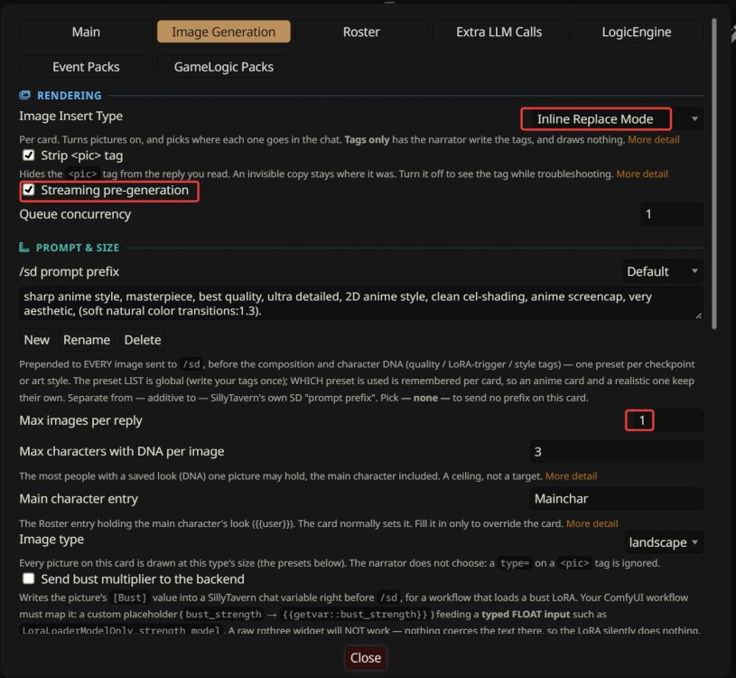
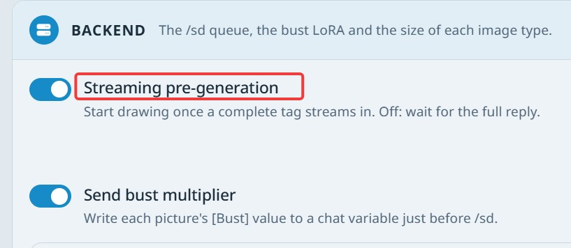
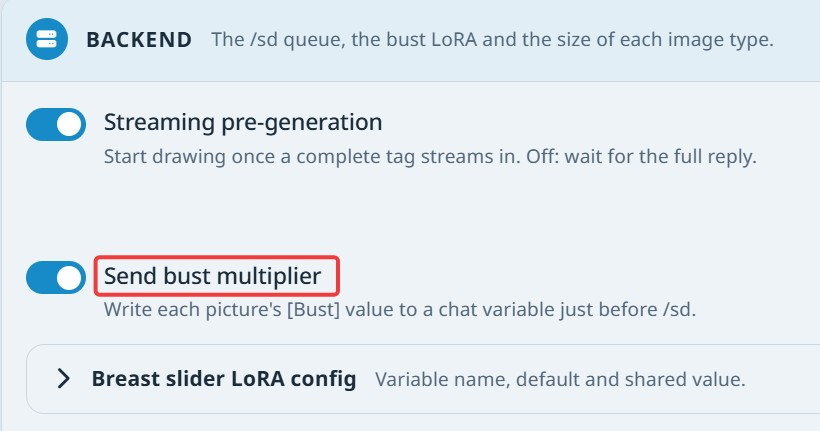

# Auto Image Generation

MVU Helper draws pictures for your story while you chat. The AI writes a small tag where a picture belongs, and MVU Helper turns it into a picture with SillyTavern's own image generation.

## Why this one is different

Most auto image generation just draws whatever the AI describes this reply. Ours keeps track of what every NPC is wearing, and I spent a great deal of thinking to get the logic right.

Every NPC registers their clothes. Then, when the story calls for it, they change into something else: a gown at the banquet, a swimsuit at the beach, casual wear for the weekend shopping trip. And those one-off clothes stick with the NPC for the rest of the scene. When the story goes back to the main line, they're back in their normal outfit. All by itself, nobody has to tell it.  NPC's face, hair style and overall look stay consistent in every single picture when you use the Krea 2 model, because the NPC's DNA is recorded.

That means a classmate wears her uniform, wear sportswear during gym class from Mon to Fri, and some casual wear on Sat when she meets you for a date. The casual wear sticks with her for the rest of Sat. When you meet her again on Mon, she's back in her **SAME** uniform.  During the gym class, she will also wear the **SAME** sportswear.  And the next week, when you date her again, she naturally changes into a **new** casual outfit on Sat.  Every character's look and wardrobe are saved once, in the chat's MVU variables: her face, hair and body, plus each outfit she owns, such as her school uniform, gym clothes and swimsuit. What she wore in her last picture is saved there too, with every message and every swipe.  No ugly hack to track the state if outfit should be removed or not when a message is deleted.  MVU variable goes poof automatically when a message is deleted, all by itself.  Most image gen extension breaks on [A week with Mitsuki](https://github.com/KritBlade/mvu-helper/blob/main/doc/roster/registry.md#a-week-with-mitsuki).

When the AI draws a picture, it never describes anyone it already knows. It picks an outfit name from a short list (we support more than 1 outfit) and mvu-helper pastes her saved description into the image prompt word for word. A brand-new outfit is described once, on the picture that first shows it. After that it is offered back to the AI so it can keep her in it.

Saved looks and outfits never go to the AI. The only exception is a one-off outfit, which the AI sees again while it is her latest one. Once she has been out of the scene and unmentioned for 10 messages (about five exchanges), the AI stops seeing it but it is still saved in MVU variables. It stays saved and comes back when she does, and it is deleted for good after 100 replies with no picture of her.  Other extension that describes every heroine in the scene, with her look and the outfit she wears now, spends about 1,800 tokens per reply on a classroom of 6.  On the other hand, mvu-helper's outfit block costs about 740 tokens, rules included, and each extra heroine adds only about 12 tokens. Over 100 replies that is under 75,000 tokens for us, against about 180,000 for other implementation. If all 21 heroines stay in the scene for those 100 replies, other implementation climbs to about 630,000 (about 6,300 tokens per reply), which is 9 times larger than ours.  **Our extension is built for a lot of casts in the game!**

How a character's look and clothes get registered is on [Roster](../roster/README.md), and how the AI picks an outfit for every picture is on [How the character registry works](../roster/registry.md).

## How it works

The AI never draws anything. It only writes down the shot: who is in it, what they're doing, where, and from which angle.

AI writes the shot > MVU Helper adds everyone's look > SillyTavern draws it > the picture lands in the chat.

The look is the important part. A character with a saved look, I call it DNA, gets the exact same hair, eyes and clothes in every picture. So Mitsuki on reply 5 and Mitsuki on reply 500 are the same girl.

So, MVU Helper will get the DNA out of every **named** NPC.

## What you need

- **SillyTavern's Image Generation extension, set up and working.** MVU Helper doesn't draw by itself. It hands every picture to SillyTavern's `/sd` command, so ComfyUI or any other backend SillyTavern supports works.  You will have to have a working installation of ComfyUI before using this function.
- **A card.** Any card works. A card built for MVU Helper sets most of the fields below for you, and brings its characters' looks with it.

### ComfyUI and one of my workflows

I made 2 ComfyUI workflows for MVU Helper. Pick one of them:

- **Anima 2.9**, for a less powerful GPU.
- **Krea 2**, for a video card with 12GB or more. It understands the scene better, so it usually draws better than Anima.

How to install ComfyUI Desktop, test the workflow, and hook it up to SillyTavern is on [Set up ComfyUI](comfyui_setup.md).

Using your own workflow instead? Test `/sd` first. Type `/sd a cat sitting on a desk` in the chat. If you get a cat, you're good. My 2 workflows wait for the bust number that only MVU Helper's own pictures set, so test those inside ComfyUI instead, as the setup page says.

## Quick start

1. Open a chat with your card.
2. Open MVU Helper > **Image Generation**.
3. Set **Image insert type** to **Inline replace mode**.
4. Pick a **/sd prompt prefix** that fits your checkpoint, or just use the Default one.
5. Send a message.



That's it. The picture shows up right under the sentence it belongs to, with a small redraw button next to it.  **You can stop reading below if you are not interested in knowing what each of the field means**.

## Per card, or for your whole PC

Most fields are per card. Each card keeps its own, and switching cards switches them. The **Card:** chip at the top of the tab names the card you're editing, so open that card's chat first. With no chat open, there's no card to save them to, so those cards grey out and the tab tells you to open a chat. A card built for MVU Helper can bring its own values with it.

A few fields describe your PC instead, and those are the same for every card. They sit together in the **Backend** card, the one with the **Global** chip: **Streaming pre-generation**, **Queue concurrency**, **Send bust multiplier** and **Resolution presets**. The list of **/sd prompt prefix** presets is shared by every card too, only the pick is per card. A card never changes them, because only you know what your GPU can handle.

## Rendering

### Image insert type

**Turns pictures on for this card, and picks where each one goes.** Per card.

| Value | What happens |
| --- | --- |
| **Disable** | no pictures. The AI isn't asked for tags, and nothing is drawn. A new card starts here |
| **Tags only** | the AI writes the tags, and nothing is drawn |
| **Insert in current message** | the picture is attached to the reply |
| **Create new message** | each picture becomes its own chat message, right after the reply |
| **Inline replace mode** | the picture takes the tag's place, right under the sentence it belongs to |

The pill at the top of the tab follows it: **Images on**, **Tags only** or **Images off**. With no chat open it hides.

Anything but Disable asks the AI for tags. That's an instruction block in the prompt on every reply, so it costs some tokens, even on Tags only.

**Inline replace mode** is the one I'd pick. The picture sits right where the story is. A manga panel next to the line it belongs to reads way better than all the panels stacked at the end of the chapter. It's also the only mode with a redraw button on each picture.

**Insert in current message** attaches the picture the way SillyTavern attaches any picture to a message. It doesn't sit at the sentence. How several pictures on one reply show up is SillyTavern's own setting.

**Create new message** posts each picture as a message of its own. It's the one mode that never starts drawing before the reply is finished, see [Streaming pre-generation](#streaming-pre-generation).

**Tags only** is for checking what the AI writes, without a GPU. Each tag's prompt goes to the console, and the tag itself is handled by [Strip `<pic>` tag](#strip-pic-tag). Handy while you set up a card, or while your GPU is busy with something else.

One thing this field doesn't decide is whether new characters' looks get saved. That's the Roster tab's job, and it works with pictures off too. See [Roster](../roster/README.md).

### Strip `<pic>` tag

**Hides the picture tag from the reply you read.** Per card, on by default.

The tag is markup for MVU Helper, not for you. It looks like this:

```
<pic char="Mitsuki" outfit="school-uniform" camera="eye-level" prompt="1girl, sitting on a bench, laughing, school rooftop, noon" mainchar="not-in-picture">
```

You don't want to read that between your sentences. So with this on, the tag leaves the text you see.

It's not deleted though. An invisible copy stays where the tag was, inside the picture in Inline replace mode. MVU Helper keeps it for 3 reasons:

- **The redraw button** draws the picture again from it, with everyone's look as it is now, and what they wear as that reply saved it.
- **The next pictures** know what each person wore last time. So Mitsuki doesn't change clothes between 2 pictures of the same scene.
- **The AI** sees its own earlier tags in the chat history, and copies the right shape next time.

It works with **Tags only** too. If you use galgame companion, keep it on. A raw tag left in the reply holds galgame up while it converts the text.

Turn it off only to troubleshoot. The tag then stays visible in the chat. In Inline replace mode it shows as plain text under the picture, or in place of a picture that failed, so galgame still reads a clean reply.

You don't need to turn it off just to see what was sent to `/sd` though. The console already has every prompt in full, see [When something goes wrong](#when-something-goes-wrong).

## Prompt & size

### /sd prompt prefix

**Tags put in front of every picture's prompt: quality, style and LoRA triggers.** The list is for your whole PC, the pick is per card.

Every checkpoint wants different tags. An anime checkpoint wants "anime screencap, cel-shading", a realistic one wants something else. So you keep one preset per checkpoint or art style, written once, and each card picks the one it uses. An anime card and a realistic card each keep their own, with no re-picking when you switch.

- **New**, the + button beside the list, asks for a name, makes the preset, and this card picks it.
- **Rename**, the pen, renames the picked one.
- **Delete**, the red bin, deletes the picked one. The list is shared by every card, so any card that used it goes to no prefix. MVU Helper asks first.
- **The text box** under them edits the picked preset's tags.
- **none**, at the top of the list, sends no prefix on this card. While it's picked, Rename, Delete and the text box are greyed out.

The built-in **Default** preset is anime style: `masterpiece, best quality, highly detailed, 2D anime style, clean cel-shading, sharp line art, anime screencap, very aesthetic`.

This comes on top of the prompt prefix in SillyTavern's own Image Generation settings. Put a tag in one place or the other, never both, or it reaches the model twice. Negative prompts stay in SillyTavern's settings.

### Max images per reply

**The most pictures one reply may have.** Per card, 1 by default, up to 10.

It's a ceiling, not a target. Set it to 3, and a reply can still come back with 1 picture. How many you actually get depends on the scene.

The AI is told that a new scene gets a new picture. Another place, a jump in time, or someone new walking in is a new scene. A new pose or more talking in the same scene isn't. So a reply that stays at the same lunch table the whole time gets 1 picture, while one that goes from the classroom to the rooftop to the walk home can get 3.

With more scenes than pictures, the last scene always gets one, because that's where the story stands now. 1 is fine for plain chat. 2 or 3 is nice with galgame companion.

A tag past the limit isn't drawn, and the console says so.

### Max characters per image

**The most people with a saved look one picture may hold, the main character included.** Per card, 3 by default.

DNA is a character's saved look: their body and their outfits, kept in the chat's character registry, the Roster tab. Someone with DNA looks the same in every picture. Someone without it is drawn from the story words alone, and comes out different every time.

This number is a ceiling, not a target. The AI still decides who's in each shot, and one person alone is a normal shot. Nobody is added just to reach 3.

Each named person takes a slot in the tag: `char=`, then `char2=`, `char3=` and so on, each with their own outfit. The main character counts toward the number too, but never takes a slot. They get `mainchar=` instead, see [Main character entry](#main-character-entry).

So why a limit at all? Because every look is copied into the prompt in full. A look like Mitsuki's is around 300 tokens. 3 people is 900 tokens of looks before the scene even starts, and every image model has a point where it loses track of who wears what.

MVU Helper does its part to keep them apart. Each person gets their own sentence, opened with their name and wrapped in their name: `Mitsuki is: [Mitsuki] … [/Mitsuki]`. Clothes everyone shares, like the same school uniform, are said once for all of them.

When the AI puts more people in a tag than this number, the main character is left out first, then the last slots. The console names everyone left out. They're still in the picture if the scene describes them, just without their look.

People without a name never count. A crowd, or "people in the background", is part of the scenery.

Raise it when your image model handles long prompts well. Models with an LLM text encoder, like Qwen-Image, keep people apart dependably up to about 1000 tokens.

### Main character entry

**The Roster entry that holds your own character's look.** Per card.

The main character is you, `{{user}}`. Your look is kept like any other character's DNA: a body, and one or more outfits. This field names that entry. ArtificKoi's is `Mainchar`.

The AI never writes your name in a tag. It writes `mainchar=` on every single tag instead:

- **an outfit**, when any part of you is in the picture. Your look is then added at the end of the prompt.
- **`not-in-picture`**, when you're not. Every pov shot is this one, because the camera is your eyes.

Here's why it works this way. If you're in the shot but your look isn't attached, the image model makes up a stranger in your place. Very often a child, wearing the other people's clothes. Not what you want in a picture of you and Mitsuki on a bench.

| `mainchar=` | Draws you |
| --- | --- |
| `default` | in your entry's `default` outfit, when it has one |
| an outfit name, like `town-casual` | in that outfit from your entry |
| `same-as-last-picture` | in what you wore in your last picture |
| `undressed` | without clothes. The scene says how |
| `not-in-picture` | not at all |

Put every name the story calls you in the entry's **Aliases** (Roster > Edit). MVU Helper then knows those names are you, and never treats them as a new character.

The card normally sets this in its own config, so most of the time it's already filled in. Type a name here only to override the card.

Blank, on the card and here, means there's no look to attach. You're still drawn when the AI puts you in a shot, just from the scene words alone.

How a look is written is on [How the character registry works](../roster/registry.md#the-entry).

### Image type

**The shape every picture on this card is drawn in.** Per card, landscape by default.

Pick portrait, landscape, closeup, scene or square. The sizes are in [Resolution presets](#resolution-presets). The AI doesn't choose, so every picture on the card has the same shape, redraws included.

## Scene gates

### Intimacy latch path

**Sends the explicit scene rules only during an intimate scene.** Per card, MVU cards only.

The explicit rules are a big block. They teach the AI how to describe an adult scene, so the image model gets it right. A normal school day doesn't need them, and sending them every reply wastes tokens.

So the card names a true/false value in its game state that flips on during an intimate scene. ArtificKoi's is `PendingState.IntimacyActive`. The rules are sent unless it reads `false`.

The card normally sets this in its own config. Set it here only to override.

| The path | Explicit rules |
| --- | --- |
| blank | always sent |
| found, and it reads `false` | not sent |
| found, and it reads anything else | sent |
| not found in the game state | not sent, and the console names the path |
| no game state loaded yet | not sent |

A path that isn't found holds the rules back on purpose. A card that set a path asked for a gate, so a broken gate fails safe. No explicit rules at all is easy to spot. Explicit rules on every SFW reply isn't.

### Always inject H guidance

**Always sends the explicit rules, whatever the latch says.** Per card, off by default.

## Teaching contract

The teaching contract is the instruction that teaches the AI how to write a picture tag. MVU Helper ships a built-in one, and a card can carry its own. Most people never touch this section.

### Prompt template

**The instruction text the AI gets.** Per card.

It's sent on every reply while Image insert type is anything but Disable. It goes at the very top of the prompt, so your provider's prompt cache can reuse it every reply.

**Reset to default** goes back to the built-in one. While a card is on the built-in one, it follows MVU Helper's updates, so a better contract in a later version reaches you by itself.

Some rules always come from MVU Helper, whatever this box says: outfits, how many pictures, the camera, and the explicit scene rules. So an old copy of the template can never miss them.

### Regex

**How MVU Helper finds the picture tags in a reply.** Per card.

Leave it alone unless the card tells you otherwise. **Reset to default** goes back to the built-in one, and a pattern that doesn't work falls back to it too.

### Scene roster placement

**Where the on-screen list goes in the prompt.** Per card.

On a card that tracks who is in the scene, MVU Helper adds a short list of who's on screen right now, so the AI draws someone who's actually there. That list changes every reply, so it doesn't go at the top with the rest.

**Position** picks the role it's sent as: system, user or AI, shown as a gear, a person and a robot in the list. **Depth** is how far back from the end of the prompt. 0 is the very end, and that's the default.

## Backend

Everything in this card is for your whole PC. That's what its **Global** chip means.

### Streaming pre-generation

**Starts drawing a picture the moment its tag is complete, while the AI is still writing.** For your whole PC, on by default.



So by the time you've read the reply, the picture is usually done. Off, and drawing waits for the whole reply.

A tag inside the AI's thinking doesn't count. And a tag with someone whose look isn't ready yet waits for the finished reply, so it's never drawn wrong.  

One catch is that some proxy or lower end model vendor might cut off the reply from time to time.  For these lower end ai model vendor, you might want to turn this off.

### Queue concurrency

**How many pictures your GPU draws at the same time.** For your whole PC, 1 by default, up to 4.

Leave it at 1 unless you know your backend handles more. ComfyUI on one GPU is most stable at 1. The other pictures just wait in line.

### Send bust multiplier

**Hands each picture a number for a breast slider LoRA in your ComfyUI workflow.** For your whole PC, on by default.



Skip this one unless your workflow loads a breast slider LoRA. Without one, the number just sits in a chat variable and nothing happens.

A character's look can carry a **Bust** value. Right before each picture, MVU Helper writes it into a SillyTavern chat variable, `bust_strength` by default.

Your workflow reads that variable through a custom placeholder in SillyTavern's ComfyUI Workflow Editor: find `bust_strength`, replace `{{getvar::bust_strength}}`. You don't type it in yourself. Turning the switch on adds it to SillyTavern's Image Generation settings, and turning it off removes it. If you already wrote your own under the same name, MVU Helper leaves yours alone.

The one part that's still yours is the workflow. Put `"%bust_strength%"` on the strength input of the LoRA node, like `LoraLoaderModelOnly.strength_model`. The Workflow Editor ticks `%bust_strength%` in its Custom list once the workflow has it.

It has to be a typed FLOAT input. A raw rgthree widget won't work. It doesn't convert the text, so the LoRA silently does nothing.

The LoRA multiplies the size the look already states. It doesn't replace it.

It needs **Queue concurrency 1**. There's only one variable, so 2 pictures drawing at once would grab each other's number. MVU Helper warns you when you turn this on above 1.

**Breast slider LoRA config** is folded right under it. Click it open:

| Field | Default | What it does |
| --- | --- | --- |
| **Bust variable name** | `bust_strength` | the chat variable it writes |
| **Default value** | 1 | the number when nobody in the picture has a Bust value |
| **Shared value** | 1.5 | the number when 2 or more people have one |

Only people with a Bust value count. With 1 of them, the picture gets theirs. 2 or more can't each get their own, because the LoRA is one strength for the whole picture. So they share one number, and their own sizes still differ in the prompt.

### Resolution presets

**The width and height of each image type.** For your whole PC. It's folded at the bottom of the Backend card.

| Type | Default |
| --- | --- |
| portrait | 768 × 1152 |
| landscape | 1152 × 768 |
| closeup | 768 × 960 |
| scene | 1152 × 672 |
| square | 1024 × 1024 |

These are about 1 megapixel, native for SDXL class checkpoints. Change them to what your GPU and checkpoint handle.

## When something goes wrong

Turn on **Image gen** in the Debug card of MVU Helper's Main tab first. The console then shows every picture: the shot the AI wrote, and the exact prompt sent to `/sd`.

- **No picture, and no toast.** The reply has no tag, so the AI skipped the instruction. A card's own output format can crowd it out. The console says so.
- **"Image generation produced no image".** `/sd` failed. Check SillyTavern's image generation, and run the test workflow inside ComfyUI, see [Set up ComfyUI](comfyui_setup.md#test-it-in-comfyui). With my workflows, also check **Send bust multiplier** is still on.
- **A character looks like a stranger.** She has no look on file. The console names her.
- **Someone is missing from the picture.** The tag had more people than Max characters per image. The console says who was left out.

## For card authors

How the tag works, what the AI is sent, how the prompt is built and where each picture goes is on [How Auto Image Generation works](technical.md).

Basically, the AI writes the shot, MVU Helper dresses everyone, and your GPU draws it.

[Back to index](../../README.md)
