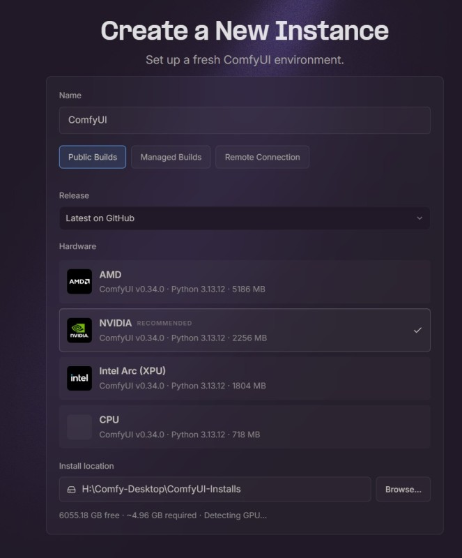
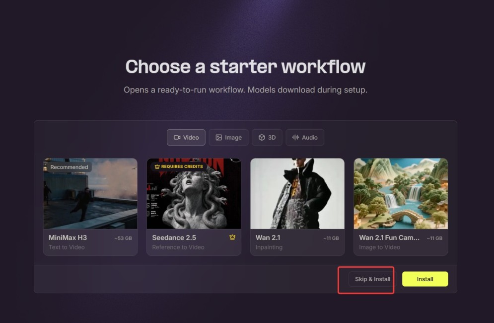
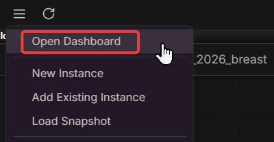
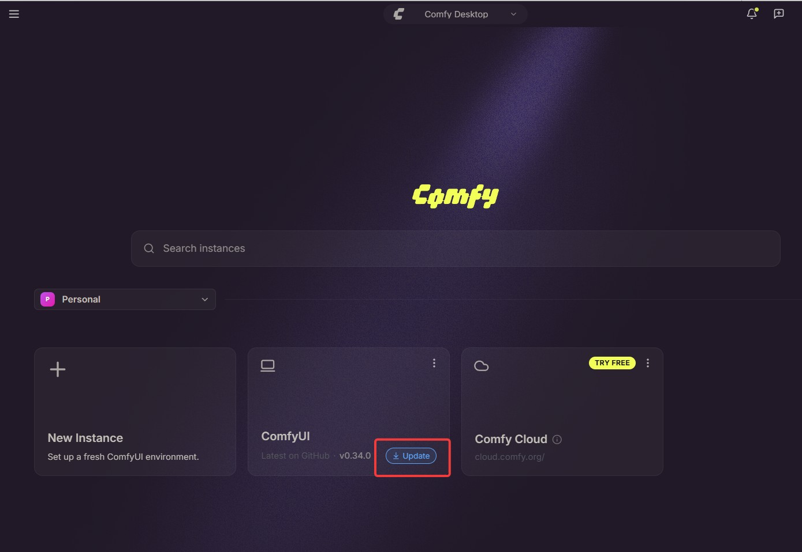
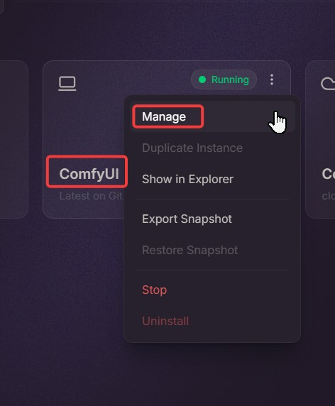
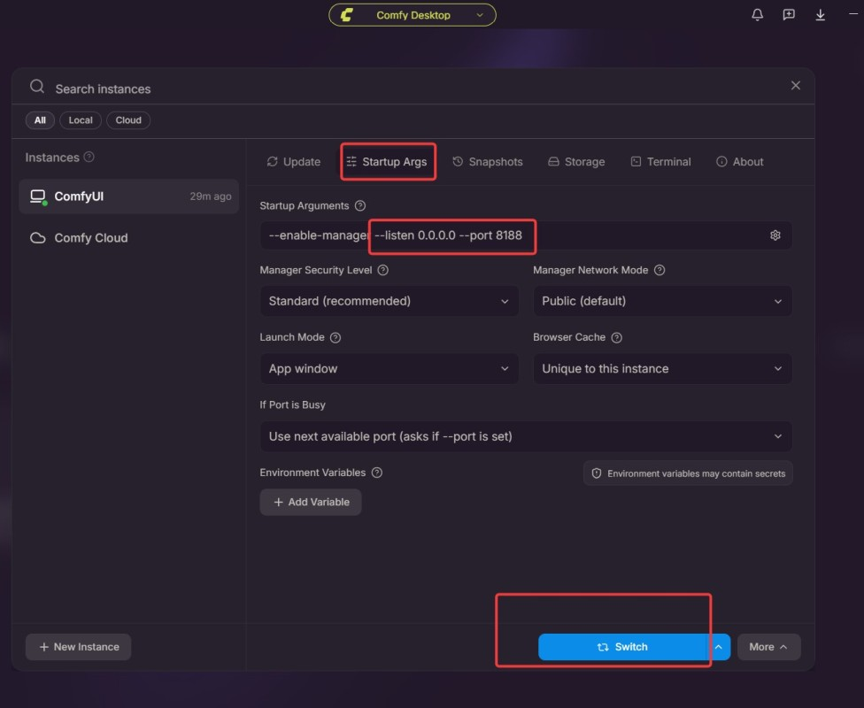
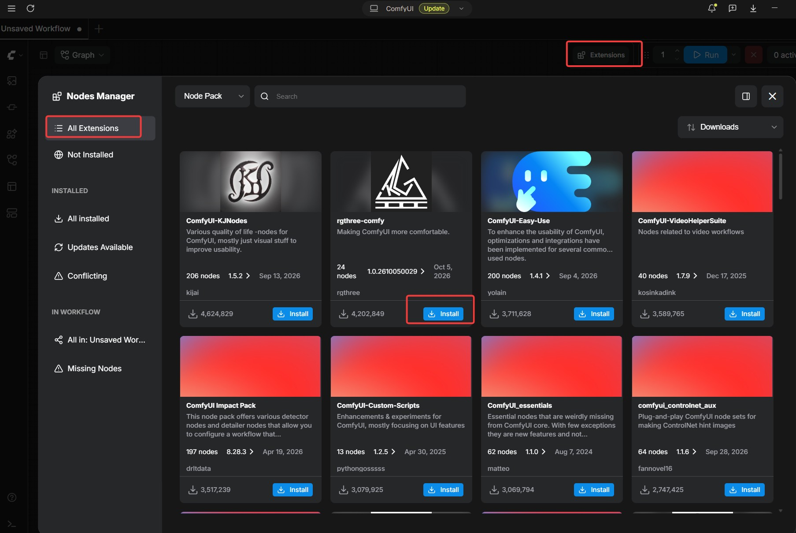
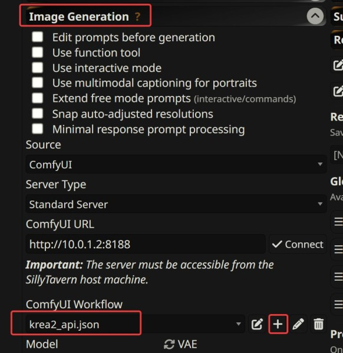

# Set up ComfyUI

This is a quick install guide for ComfyUI Desktop, written for beginners. Follow it step by step, and you end up with a ComfyUI that SillyTavern can draw with, plus one of my 2 workflows.

If you want the advanced features, install the ComfyUI portable version instead. It can do a lot more, but you will have to sort out a LOT of package dependencies yourself. That's not what this page is for.

## Pick a workflow

I made 2 workflows for MVU Helper. You only need one of them.   MVU-Helper is tuned for using Krea2, but I leave Anima here for lower end video card users.

| Workflow | For | Files |
| --- | --- | --- |
| **Anima 2.9** | a less powerful GPU with 6GB VRAM | [anima2.9-api.txt](../../comfyui-workflow/anima2.9-api.txt), test: [anima2.9-test.json](../../comfyui-workflow/anima2.9-test.json) |
| **Krea 2** | a video card with 12GB or more | [krea2-api.txt](../../comfyui-workflow/krea2-api.txt), test: [krea2-test.json](../../comfyui-workflow/krea2-test.json) |

Krea 2 understands the scene better, so it usually draws better than Anima. And Krea2 can ALWAYS draw the same girl exactly the same with the same DNA.   Anima would struggle when more than 1 girl on the scene.   If your video card has 12GB or more, pick Krea 2. Below that, pick Anima.

Each one comes in 2 files. The `-test.json` is for ComfyUI itself, so you can check it draws. The `-api.txt` is the one SillyTavern uses.

## Install ComfyUI Desktop

### 1. Install CUDA

On Windows with an NVIDIA card, install CUDA v13 first: https://developer.nvidia.com/cuda-downloads

### 2. Download ComfyUI Desktop

Go to https://comfy.org/download, and download the Windows or Mac version.

### 3. Create the instance

Run the installer. Under **Release**, choose **Latest on GitHub**, and pick your hardware.



### 4. Skip the starter workflow

When it asks you to choose a starter workflow, just click **Skip & Install**. Those are big downloads you don't need.



### 5. Open the dashboard

After ComfyUI Desktop launches, click the menu in the upper left corner, and choose **Open Dashboard**.



### 6. Update it

You should see the ComfyUI instance with an **Update** button on it. Click it, and let it restart.



### 7. Manage the instance

After the restart, go back to the dashboard. Click the 3 little dots on the ComfyUI instance, and choose **Manage**.



### 8. Let SillyTavern reach it

Click **Startup Args**, and add this to the startup arguments:

```
--listen 0.0.0.0 --port 8188
```

Then click the **Switch** button at the bottom.



`--listen 0.0.0.0` lets other machines on your network reach ComfyUI, so SillyTavern can talk to it even when it runs on another PC. It also means anyone on that network can. Fine at home, not on a public wifi.

### 9. Install the extensions

Click the **Extensions** icon, top middle right. Search for each of these, and install it:

| Extension | Picture |
| --- | --- |
| rgthree-comfy | [rgthree.jpg](../../image/image_gen/rgthree.jpg) |
| ComfyUI Anima Remap | [anima_remap.jpg](../../image/image_gen/anima_remap.jpg) |
| ComfyUI-Easy-Use | [comfyui-easy-use.jpg](../../image/image_gen/comfyui-easy-use.jpg) |
| ComfyUI-EulerFlowMatchingDiscreteScheduler | [ComfyUI-EulerFlowMatchingDiscreteScheduler.jpg](../../image/image_gen/ComfyUI-EulerFlowMatchingDiscreteScheduler.jpg) |



Then apply the changes at the bottom of the screen.

### 10. Restart

Close ComfyUI Desktop, and launch it again.

### 11. Download the models

Now download the models for the workflow you picked. Every file goes into a folder under `models`, inside your ComfyUI install. With the default install location, that's:

```
C:\Comfy-Desktop\ComfyUI-Installs\ComfyUI\ComfyUI\models\
```

If you picked another install location in step 3, start from that one instead.

The workflow looks each file up by its exact name. So when a download comes with another name, rename it to the one in the table.  
**You only need to pick either Krea2 or Anima 2.9.  You do NOT need to download both model.**

#### Krea 2

| Download | Save into | The workflow loads it as |
| --- | --- | --- |
| [Huihui-Qwen3-VL-4B-Instruct-abliterated-fp8_scaled](https://huggingface.co/ahmed22xa/Huihui-Qwen3-VL-4B-Instruct-abliterated-comfy/tree/main) | `models\text_encoders` | `Huihui-Qwen3-VL-4B-Instruct-abliterated-fp8_scaled.safetensors` |
| [qwen_image_vae](https://huggingface.co/f5aiteam/VAE/tree/main) | `models\vae` | `qwen_image_vae.safetensors` |
| [Krea2 Cat Tower v1.0 (Turbo INT4 ConvRot)](https://civitai.com/models/2805913/krea2-cat-tower?modelVersionId=3165660) | `models\diffusion_models` | `krea2CatTower_v10TurboINT4Convrot.safetensors` |
| [Krea2 Filter Bypass (fedor)](https://civitai.red/models/2746817/krea2-filter-bypass-fedor) | `models\loras` | `fedor_bypass.safetensors` |
| [SNOFS](https://civitai.red/models/1972981/snofs-sex-nudes-other-fun-stuff?modelVersionId=3390681) | `models\loras` | `snofs_krea_v1_5.safetensors` |
| [[KREA2] Breast Slider](https://civitai.red/models/2993835/krea2-breast-slider?modelVersionId=3395188) | `models\loras` | `breast_size_v2_krea2_loraholic.safetensors` |

Take Krea2 Cat Tower **v1.0 Turbo INT4 ConvRot**. It's about 7.5GB, small enough for a 12GB video card.  If you have 16GB VRAM, download the [(Turbo INT8 ConvRot version)](https://civitai.com/models/2805913/krea2-cat-tower?modelVersionId=3163788) .   Do NOT download v2.0 raw, it won't work with this workflow and I found it does wierd thing in NSFW scene.

The INT4 version needs ComfyUI v0.28 or later. The update in step 6 gives you that.

#### Anima 2.9

| Download | Save into | The workflow loads it as |
| --- | --- | --- |
| [Anima text encoder](https://huggingface.co/circlestone-labs/Anima/tree/main/split_files/text_encoders) | `models\text_encoders` | `qwen306BBaseAnima_1.safetensors` |
| [qwen_image_vae](https://huggingface.co/f5aiteam/VAE/tree/main), the same file as Krea 2 | `models\vae` | `qwen_image_vae.safetensors` |
| [Anima Cat Tower Plus](https://civitai.red/models/2983186/anima-cat-tower-plus?modelVersionId=3381954) | `models\diffusion_models` | `animaCatTowerPlus_v01_bf16.safetensors` |
| [anima29b-turbo-v2.9-remap](https://huggingface.co/Langzaigg/anima29b-turbo-unofficial/tree/main) | `models\loras` | `anima29b-turbo-v2.9-remap.safetensors` |
| [Breasts Slider](https://civitai.red/models/2905521/breast-size-slider?modelVersionId=3285828) | `models\loras` | `anima_breasts.safetensors` |

## Test it in ComfyUI

### 12. Run the test workflow

Drag the test workflow you picked, `anima2.9-test.json` or `krea2-test.json`, into ComfyUI Desktop.

Press the **R** key. That reloads the model list, so ComfyUI sees the files you just put in the folders.

If any box in the workflow turns red, ComfyUI can't find that model. Click the box, and pick the file you just downloaded. Then rename that file to the name in the table in step 11 too, because SillyTavern's copy of the workflow looks for that exact name.

Click **Run**. You should get a picture.

If something goes wrong, go through steps 1 to 11 again. A missing extension or a misnamed model is the usual one. When a model file is missing, ComfyUI names it when you click Run.

## Hook it up to SillyTavern

### 13. Add the workflow to SillyTavern

Go to SillyTavern > Extensions > **Image Generation**:

1. Set **Source** to **ComfyUI**.
2. Put your ComfyUI address in **ComfyUI URL**, like `http://127.0.0.1:8188` on the same PC, and click **Connect**.
3. Next to **ComfyUI Workflow**, click the **+** sign, and type a name to create a new workflow.
4. Copy everything inside `anima2.9-api.txt` or `krea2-api.txt` into it, and save.



Then go back to the [Quick start](README.md#quick-start), and send a message.

Don't test this one with a plain `/sd a cat` though. The workflow waits for the bust number, and only MVU Helper's own pictures set it, see below.

### Keep the bust multiplier on

Both workflows already carry `"%bust_strength%"` on their breast slider LoRA. So keep **Send bust multiplier** on, in the Backend card of MVU Helper's Image Generation tab. It's on by default.

Turning it on is what adds the matching placeholder to SillyTavern. Turn it off, and the placeholder goes away, the text `%bust_strength%` reaches ComfyUI as it is, and ComfyUI refuses the job because that's not a number. See [Send bust multiplier](README.md#send-bust-multiplier).

Basically, ComfyUI Desktop, 4 extensions, one workflow pasted into SillyTavern, and you're drawing.

[Back to Auto Image Generation](README.md) · [Back to index](../../README.md)
