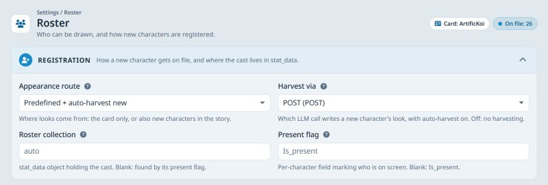
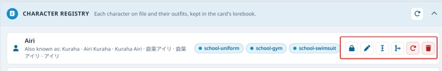

# Roster

The Roster is MVU Helper's character registry. Every named NPC gets their look written down once, and from then on every picture of them uses it.

## What it does

The first time the story names a new character, the AI describes them once: their body, and what they're wearing. MVU Helper saves that as an entry in your card's lorebook. That saved look is what I call the character's DNA.

After that, the AI never describes them again. It only writes their name, and MVU Helper adds the saved look to every picture of them. So Mitsuki has the same plum-purple hair and the same golden eyes on reply 5 and on reply 500.

Think of a hair salon's client card. The first visit, they write down your cut and your colour. Every visit after that, nobody asks you again, they just read the card. You get the same haircut no matter which stylist is on shift.

Clothes work the same way, with one twist. Your classmate's school uniform is saved, so she always wears the exact same uniform. But a dress she wears to one party is not saved, it's worn for that scene only. How that works is on [How the character registry works](registry.md).

The Roster works with or without pictures. With [Auto Image Generation](../image_gen/README.md) on, it's what keeps every picture consistent.

## Quick start

1. Open a chat with your card.
2. Open MVU Helper > **Roster**.
3. Set **Appearance route** to **Predefined + auto-harvest new**.
4. Set **Harvest via** to **narrate**.
5. Chat. New characters show up in the **Character registry** list as the story meets them.

In my screenshot, Harvest via is on a POST call. Either one works.

That's it. Check the list now and then. If the AI described someone in a way you don't like, fix it with the edit button.

## Registration

### Appearance route

**Whether new characters get saved.** Per card.

| Value | What happens |
| --- | --- |
| **Predefined only** | only the characters the card already brings are on file. Anyone else is described by the story for that reply's pictures, and forgotten after |
| **Predefined + auto-harvest new** | every new character is described once, and saved. A character already on file is never asked about again |

A card built for MVU Helper usually brings its main cast already on file. ArtificKoi brings every classmate, each with her school uniform, gym uniform and swimsuit. Auto-harvest is for everyone else the story meets along the way.

### Harvest via

**Which AI call writes a new character's look.** Per card, Off by default.

Only matters on **Predefined + auto-harvest new**. While it's Off, nothing is saved, even with auto-harvest picked. You have to pick one to start saving.

| Value | What happens |
| --- | --- |
| **Off** | nothing is saved |
| **narrate** | your main AI describes each new character in its own reply. No extra call |
| a POST call | a separate call after the reply describes them. Only shows up when the card has a POST call, see [Extra LLM Calls](../extra_llm_calls/README.md) |

**narrate** is the simple one, and it costs nothing extra. Your main AI is already writing the reply, so it adds a short description of anyone new at the end.

A **POST call** is a focused pass that only does this one job, so it's often more careful. The catch is that a picture of someone new waits for it, because their look only exists after the POST call is done.

Either way, the AI ends every reply with one short line per named character in the scene, like `<cast name="Mitsuki">`. That's how MVU Helper knows who's in the reply. A card can hide those lines with a regex.

### Roster collection

**Where your card keeps its characters, in the game state.** Per card, MVU cards only.

Every MVU card keeps its characters somewhere in the game state, under whatever name the card picked: `Classmate`, `Partner`, `关系列表`. Leave this blank, and MVU Helper finds it by itself. Fill it in only when it guesses wrong.

MVU Helper uses it to tell the AI who's on screen right now, so a picture uses each character's exact name.

### Present flag

**The field that marks a character as on screen.** Per card, MVU cards only.

Leave it blank to use `Is_present`. Your card's characters might use another name for it, like `inHere` or `在场`, and then you type that one here.

A card that uses another name and leaves this blank gets no on-screen list. The console says so.

## Character registry

This is the list of every character on file for this card, 10 to a page.

Each row shows the character's name, a badge for each of their outfits, and the other names they go by, after "also". Then the buttons:

| Button | What it does |
| --- | --- |
| lock / shirt | whether the story may change their saved clothes. Lock, the default: never. Shirt: the story may correct them. Their body is never changed either way |
| pen | edit the entry by hand |
| I-beam | rename it. For a name saved in the wrong spelling or script |
| merge | merge it into another entry. For one character saved twice |
| circle arrow | re-harvest: delete the entry, so the story describes them again next time they show up |
| bin | delete the entry |

The circle arrow next to the **Character registry** title refreshes the list.

### Edit

The pen opens the entry as text. Fix whatever you don't like, and save.

You will want to do this. The AI's first description is a good start, not always what you pictured. Whatever you save sticks with that character from then on. How an entry is written is on [How the character registry works](registry.md#the-entry).

### Rename

For a character whose look is right but whose name is saved wrong. Like a girl the story calls 美月, saved as "Mitsuki".

The look is kept, and the old name still works. It just becomes another name for the same character.

### Merge

For one character saved twice under 2 spellings, like "Nanami" and "Nanami Kujou".

Click merge on the one to throw away, and pick the one to keep. The one you keep keeps its look. The other one's look is thrown away, and its name becomes another name for the one you kept. So the story can write either spelling, and it's the same girl.

Sometimes the list shows a name with no look at all. That's a name a picture used before anyone described them. Give it a look with the pen, or merge it into the entry it belongs to.

### Re-harvest

Deletes the entry, so the AI describes them from scratch the next time they show up. Use it when a look is so far off that rewriting it by hand isn't worth it.

It only works on **Predefined + auto-harvest new**, with **Harvest via** picked. Otherwise nobody describes them again.

## Where the looks live

Every entry is a lorebook entry in your card's own lorebook, named `[mvu-helper-char-image] <name>`. It's disabled, so your main AI never reads it as part of the story. MVU Helper reads it only when it builds a picture.

So you can also see and edit every look in SillyTavern's own World Info editor, like any other entry.

## When something goes wrong

- **A character looks like a stranger.** They have no look on file, or a name with no look. Check the list, and give them one.
- **One character shows up twice in the list.** Merge them.
- **The list stays empty.** Check **Appearance route** is on auto-harvest, and **Harvest via** isn't Off.
- **A saved outfit is wrong.** Edit it. It sticks from then on.

## For card authors

How an entry is written, when clothes get saved, and how the AI is told who's on file and what they can wear is on [How the character registry works](registry.md).

Basically, every character is described once, saved once, and drawn the same way every time after that.

[Back to index](../../README.md)
