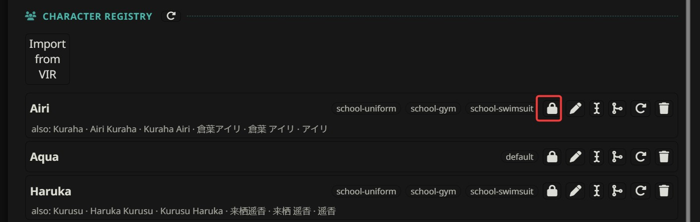

# How the character registry works

> This page applies to any card. ArtificKoi shows up as a real example, not as a rule.

Every character on file is one lorebook entry: who they are, and the clothes they own. The AI is told who's on file and which clothes each one has, and it picks from that list for every picture. Clothes the story puts them in for one scene are kept in the game state instead.

## The entry

An entry is a disabled lorebook entry named `[mvu-helper-char-image] <name>`, in the card's own lorebook. Its text is a few labelled sections. Here's ArtificKoi's Mitsuki, shortened:

```
[Body]
slim, adult hourglass figure, long legs, (golden eyes:1.1), warm honey-colored eyes, fair skin, … (plum-purple hair:1.3), (pink-purple gradient hair:1.15), long hair, straight hair, center-parted bangs, …
[Bust]
1.7
[Clothes:school-uniform]
brown academy uniform, cream short-sleeve sailor blouse, brown sleeve cuffs, … brown plaid pleated skirt, dark knee-high socks with light trim, brown rounded-toe loafers
[Clothes:school-gym]
academy gym uniform, white short-sleeve athletic shirt, navy-blue athletic shorts, white ankle socks, white sneakers
[Clothes:school-swimsuit]
navy one-piece classic academy swimsuit, white name tag on chest, bare shoulders, bare legs, barefoot
[Alias]
Tachibana
Mitsuki Tachibana
橘美月
美月
```

| Section | What it holds |
| --- | --- |
| `[Body]` | who they are on ANY day: what they are, face, hair, eyes, build. Never clothes, never a wound or a blush from one scene |
| `[Clothes]` | their default outfit. Picked as `default` |
| `[Clothes:<name>]` | a named outfit, like `school-uniform`. Picked by its name |
| `[Alias]` | other names for the same character, one per line. The story can write any of them |
| `[Bust]` | a number for the breast slider LoRA, see [Auto Image Generation](../image_gen/README.md#send-bust-multiplier). Never part of the prompt |
| `[AllowUpdate]` | `true` lets the story correct their saved clothes. Absent means `false` |

The name in the entry is the story's own spelling, in the story's own script. `[Body]` and the clothes are always English tags, whatever language the story is in, because the image model only reads English.

Mitsuki has no plain `[Clothes]`, only named outfits. So `default` means nothing for her, and the AI is never offered it.

## How a character gets on file

Every reply, the AI ends with one record per named character in the scene:

```
<cast name="Mitsuki">
<cast name="Haruka">
```

That's the cast of the reply. Someone already on file gets their name and nothing else.

Someone new gets a full description on the same line, once:

```
<cast name="Rin" body="woman, petite, small round face, … black hair, …" clothes="white blouse, navy pleated skirt, …" outfit="newclothes">
```

MVU Helper saves it as Rin's entry. From the next reply on, Rin is on file, and the AI only writes her name.

Who writes that description is the Roster tab's **Harvest via**:

- **narrate**: the main AI, at the end of its own reply. It's shown who's on file, so it describes only the rest.
- **a POST call**: a separate call after the reply. It's told each turn exactly who's new, so it describes only them. Pictures of someone new wait for it, so the first picture already uses the saved look.

A few rules keep the names usable:

- **Named means named.** "The waiter" or "a guard" is never saved. An entry under a role could never be matched again.
- **The story's spelling, every time.** 美月 stays 美月, never "Mitsuki". The same character spelled 2 ways ends up as 2 entries, which is what Merge on the Roster tab fixes.
- **Never the user's own character.** The AI is told every name you go by, and a record under one of them is ignored.

## When clothes get saved

This is the part that makes the pictures feel right.

By default, clothes are saved to a character's entry in only 2 cases:

1. **They have no clothes on file yet.** Their first clothes are always saved. A newcomer's description, or a character on file with only a `[Body]`, keeps the first clothes the story gives them.
2. **It's a uniform kind of outfit**, the kind that looks exactly the same every time. A place or a role fixes it, the same for everyone there, like a café's waitress uniform or a police uniform. Or the story presents it as what this character always wears.

The second kind is saved under a `<place or role>-<outfit>` name: `cafe-waitress`, `police-uniform`, `detective-coat`. Lowercase English words joined by `-`, even when the story is in Chinese.

A bare word is refused: "swimsuit", "casual", "uniform". The name is all the AI is ever shown of an outfit, so it has to say which clothes it is. Every swimsuit in the world would match "swimsuit".

Everything else is a one-off, and it's never saved to the entry: the dress for the banquet, the outfit for Saturday's date, the pajamas at a sleepover.

### So every character gets their first clothes

That means every NPC gets their first clothes saved automatically, the moment the story first describes them. Those clothes then stick with that character, every picture, until the story changes them.

The AI's first description is a good start, not always what you pictured. So check the Roster list, and edit whatever you don't like. What you save is what they wear from then on.

A card built for MVU Helper usually ships its main cast with their outfits already written. ArtificKoi ships every classmate with `school-uniform`, `school-gym` and `school-swimsuit`.

### Corrections: `[AllowUpdate]`



Saved clothes are never overwritten by the story. Not by default.

The reason is that the AI can't tell a correction from a paraphrase. "brown blazer, brown skirt" and "brown skirt, brown blazer" are one outfit and 2 different strings. So instead of guessing, the entry has a toggle, the lock and shirt button on the Roster tab.

With `[AllowUpdate]` on, the story may correct a saved outfit:

- **through a POST call**, when it reports the character wearing one of their outfits differently,
- **through narrate**, only on a reply whose prompt didn't show the AI that character's saved clothes.

It never happens on a reply that drew them in a one-off, and `[Body]` is never touched either way.

## One-off clothes live in the game state

When the story changes someone's clothes, the picture names them as `outfit="newclothes"`, and that character's record in the same reply carries what they now wear:

```
<pic char="Mitsuki" outfit="newclothes" camera="eye-level" prompt="1girl, standing at the station gate, waving, …" mainchar="not-in-picture">
…
<cast name="Mitsuki" outfit="newclothes" clothes="white frilled blouse, light blue denim skirt, white ankle socks, white sneakers, small straw shoulder bag">
```

The picture is drawn in those clothes. They're not saved to her entry, because her first clothes are already on file.

Instead, MVU Helper remembers what each character wore in their last picture, in the game state:

```json
"mvuhelper": {
  "worn_outfit": {
    "Mitsuki": { "outfit": "newclothes", "clothes": "white frilled blouse, light blue denim skirt, …", "last_picture_message": 58 }
  }
}
```

It's written at the end of every reply that draws pictures. MVU saves the game state with every single reply and every swipe, so this record follows the chat by itself. Delete the reply, and the one-off is gone with it. Swipe, and each swipe has its own. Nothing is left behind to show up in a later picture.

Someone no picture has drawn in more than 100 replies is dropped, so the record doesn't keep everyone ever drawn in a long chat.

A card whose Zod schema strips what it doesn't list has to list `mvuhelper` with its `worn_outfit`. Otherwise nothing anyone wore is remembered, and the console says so once per chat.

## What the AI is offered: `<reply_cast>`

The AI can't see the registry. So every reply, MVU Helper hands it a block that says who's on file and what each one can wear. It's sent whenever pictures or harvest are on.

Here's roughly what ArtificKoi's AI gets on the Saturday afternoon of a date with Mitsuki:

```
<reply_cast>
After the story, write one record for EVERY named character present in this reply — speaking, acting or shown on the page. …
<cast name="the name as the story writes it">
…
- Never the user's own character, who goes by: <your persona name>, Mainchar. A record under any of these names is ignored.
- Every reply, even when nobody is new.
ON FILE — characters whose look is stored. Each line names one or more of them, then the outfit= choices a picture of any of them picks from. Never write body= for them; their stored look is used:
- Mitsuki, Haruka, Iori: school-uniform, school-gym, school-swimsuit
"same-as-last-picture" is also a choice for these, and draws what they wore in their last picture — the outfit or clothes after their name:
- Mitsuki: white frilled blouse, light blue denim skirt, white ankle socks, white sneakers, small straw shoulder bag
- {{user}} (mainchar=): town-casual
Anyone this reply names who is not on this list has no outfit on file, however often the story has met them before — this list is all that is on file: a picture of them is "newclothes" or "undressed".
…
</reply_cast>
```

### The ON FILE list

The list is every character with a look on file whom the story has named anywhere in this chat, plus anyone the game state marks as on screen. It does 2 jobs.

First, nobody on it is described again. Their name is enough.

Second, it gives each one their outfit choices. Characters who own the exact same set share one line, so a whole class in the same uniforms costs one line, not 20.

Anyone not on the list has no outfit on file, however familiar they feel to the AI. Their picture is `newclothes` or `undressed`, never an outfit name the AI remembers from the lore.

### The outfit choices

For every person in a picture, the AI picks one:

| `outfit=` | Draws them in |
| --- | --- |
| an outfit on their line, like `school-uniform` | those saved clothes |
| `same-as-last-picture` | what they wore in their last picture, listed after their name |
| `newclothes` | clothes none of the above are. Described on their record in the same reply |
| `undressed` | no clothes. The picture says how |

The AI observes the shot. It never has to judge whether something changed since the last picture. It just reads the list and picks.

## How "same-as-last-picture" works

`same-as-last-picture` is offered per character, on a line of its own, with what it would draw written right after the name: an outfit's name, or the one-off's clothes.

That's the trick. The AI doesn't have to remember what Mitsuki wore 3 replies ago. It reads it off the list, compares it with the story, and picks it only while the story still has her in those clothes. A swimsuit offered for a classroom scene is visibly wrong, so it isn't picked.

It's only offered while the story is with that character: named in the last 10 messages, or on screen. A one-off from days of story ago isn't worth offering, and isn't printed every reply.

The main character gets the same line, `{{user}} (mainchar=)`, for their `mainchar=`. The story is always with you, so it's offered whenever the record holds what you wore.

## A week with Mitsuki

Here's the whole thing over one in-game week:

- **Monday to Friday.** Mitsuki is on file with `school-uniform`. Every picture at school picks it, and she's in the exact same uniform every time.
- **Saturday morning, a date.** The story puts her in something casual. The picture says `newclothes`, and her record describes the blouse and the denim skirt. That's drawn, and remembered in the game state.
- **The rest of Saturday.** Her line offers `same-as-last-picture: white frilled blouse, light blue denim skirt, …`. The story is still on the date, so the AI picks it, and she keeps the same outfit all afternoon.
- **Monday.** Back at school. The story has her in uniform again, so the AI picks `school-uniform`. Nobody had to tell it.
- **Next Saturday.** Another date. The story describes a new casual outfit, so it's `newclothes` again, and she wears something new.

Nobody edits anything during that week. The uniform comes from her entry, the date clothes from the game state, and the AI only ever picks from a list.

## An adventure party

It works the exact same way in an RPG. Say the party is Mainchar, Lia, Engni, Fern and Nyx, all on the Roster:

- **Mainchar** is you, a warrior in light armor. Your look is your Main character entry, so you write it yourself, or the card brings it.
- **Engni** is a nun, the party's priest.
- **Lia** is an assassin in leather armor.
- **Fern** is a mage in a robe.
- **Nyx** is a warrior in heavy armor.

Here's how their clothes go over the adventure:

- **The story starts.** The story describes each girl the first time she shows up. Her adventure gear is her first clothes, so it's saved as her `[Clothes]`, her `default`.
- **You check the list.** Say the AI gave Fern a blue robe, and you pictured her in black. Open her entry with the pen, fix the robe, and save. From then on, Fern's robe is black in every picture.
- **On the road.** Every picture picks `default`. Each girl wears the exact same gear in every fight, every camp and every town.
- **The banquet.** Everyone dresses up according to the prose by AI model.  Then, each girl's picture says `newclothes`, and her record describes her gown. The gowns are drawn and remembered in the game state, not saved to anyone's entry.
- **The rest of the banquet.** Each girl's line offers `same-as-last-picture`, with her gown written after her name. The story is still at the banquet, so the AI picks it, and Lia wears the same gown all night. Same for the other 3.
- **Back on the road.** The story has them in their gear again, so the AI picks `default`. The next picture records `default` for each of them, and the gowns are gone.


All of that happens by itself. The only thing you touched was Fern's robe, once.

Mainchar is the one exception. The main character never wears a one-off, only the outfits in your own entry. That's because a one-off is drawn from what the story writes about the clothes, and I doubt the story will ever prose what the main character looks like. The story sees through your eyes, so there's nothing to draw a one-off from.   From my experience with different AI model, almost no AI model will ever prose how the main char looks like or how he dresses.

So if you want Mainchar dressed up at the banquet too, add a second outfit to your entry by hand, like `[Clothes:banquet-formal]`.

## Checking your work

Turn on the **Roster** debug domain in MVU Helper's Main tab. The console then logs every registration: who was saved, and which clothes were kept under what name. Clothes the rules refused, like a bare "swimsuit" name, are warned whatever the setting, with the reason.

The **Image gen** domain shows, for every picture, where each person's body and clothes came from: `stored`, `reply`, or `carried` from the game state. See [From tag to `/sd`](../image_gen/drawing.md#checking-a-picture).

Basically, the entry holds who they are and what they always wear, the game state holds what they wear today, and the AI picks from a list instead of remembering.

[Back to Roster](README.md) · [Back to index](../../README.md)
