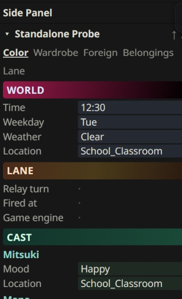

# Side Panel

The side panel is a drawer at the right edge of the chat. Your game and your plugins can each put a box in it, to show the numbers they keep: the time, the weather, who's around, what's in your bag.



## What the player sees

When a card has something to show, a small arrow shows up at the right edge of the chat. Click it, and the drawer slides open. Click it again, and it closes.

Inside, every game or plugin that has something to show gets its own box. I call that box a slot. Each slot has:

- a title, like "Weather" or "Standalone Probe",
- tabs, when it has more than one page,
- **↑** and **↓** arrows, to move it up or down the list,
- a click on its title to fold it away, and another to open it again.

The order and the folded slots are remembered. A card with nothing to show has no arrow at all.

## Why it's there

MVU keeps every number your game tracks. But those numbers sit in the save, where the player never sees them, unless the AI happens to mention one in the story.

The side panel puts them on screen, all the time, without asking the AI for anything.

Think of a car's dashboard. The speedometer reads the engine, it doesn't drive the car. You glance at it whenever you want, and it's always right, because it reads the real thing. The side panel is that dashboard for your game.

## `panel.json`: telling MVU Helper what to draw

A slot is one small JSON file, `panel.json`. It's a layout config: it tells MVU Helper how to draw your slot, and MVU Helper does the drawing. You don't write any HTML, any script or any CSS.

It does 3 jobs:

- **The layout.** Which tabs, which blocks, which rows, in what order.
- **Where each value comes from.** Every row points at a spot in the save, like `World.Time`. The file never holds a value itself.
- **The colors.** A fixed color, or a rule like "red below 20". Still JSON, still no CSS.

Here's a whole slot, with 2 rows:

```json
{
  "kind": "slot-list",
  "format": "1.0",
  "title": "Weather",
  "tabs": [
    { "id": "now", "name": "Now", "blocks": [
      { "type": "fields", "fields": [
        { "label": "Time",    "path": "World.Time" },
        { "label": "Weather", "path": "World.Weather" }
      ] }
    ] }
  ]
}
```

Think of a spreadsheet template where every cell points at the save. Every time the state changes, MVU Helper reads the real numbers and fills them in. So the panel is never out of date, and it never makes anything up.

A row can also show a whole list, like every classmate, each with her mood under her name. You never write a single name, so a classmate who joins next week shows up by herself. See [`collection`: one group per key](technical.md#collection-one-group-per-key).

What it can't do is work anything out: no math, no counting, no "pick the highest". When a value needs that, your engine works it out, and `panel.json` points at the answer. See [Computing a slot instead](technical.md#computing-a-slot-instead-renderpanel).

### Where it lives

- **While you build it,** in your workspace, inside the artifact's folder: `panel/panel.json`. Like `workspace/plugin-standalone-probe/panel/panel.json`.
- **On the card,** after install, as a hidden lorebook entry: `[GameLogicPlugin:<id>:Panel]` or `[GameLogicPack:<id>:Panel]`. The side panel reads that entry, and the dev loop rewrites it every time you save the file.

Every key, every path and every color rule is on [How the side panel works](technical.md): [blocks](technical.md#blocks), [paths](technical.md#paths), [colors](technical.md#colors) and [what warns](technical.md#what-warns-and-what-refuses).

## Who can have a slot

- **A GameLogic Pack,** your game itself. Its rows read the whole save.
- **A GameLogic Plugin.** Its rows read its own drawer, and can also read the game it sits on.

A StatusMenu Pack can't have one. It already has a whole screen of its own.

## Where to start

ArtificKoi doesn't have a slot yet.

The working example is the `plugin-standalone-probe` sample in the [template workspace](../gamelogic_engine/install.md#the-template-workspace). Its [panel.json](https://github.com/KritBlade/mvu-helper/blob/mvu-helper-template/workspace/plugin-standalone-probe/panel/panel.json) uses every feature: tabs, headings, colors, gradients, a list of characters, and each character's belongings under their name.

Copy it, delete what you don't need, and point the rows at your own numbers.

How to write one, row by row, is on [How the side panel works](technical.md).

Basically, you say which numbers to show, and MVU Helper keeps them on screen.

[Back to index](../../README.md)
