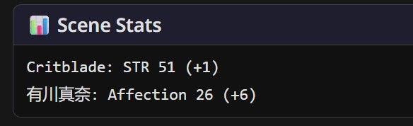
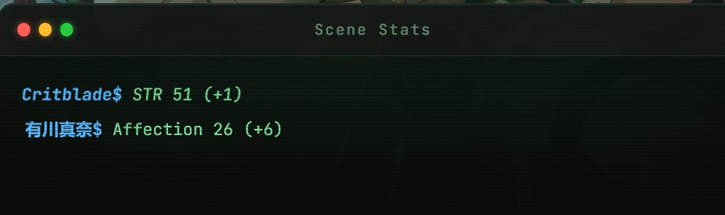

# Stat Box

The stat box is a small summary at the end of every reply: which of your stats moved, and by how much. Only the ones that moved.

```text
Critblade: STR 51 (+1)
Mana Arikawa: Affection 18 (+3)
```



That's ArtificKoi's "Scene Stats" box, after a reply where you charmed Mana a little.

## Why it's there

MVU tracks every number in your game. But the player never sees a number move, unless the AI happens to mention it in the story. And when the AI does mention one, it can get it wrong.

The stat box shows the real change, every reply, straight from the save. The AI never writes it, so it can't make up a number.

Think of the text your bank sends after you pay for something: "-$12, balance $88". It doesn't list everything in your account. It tells you what just changed, right when it changed.

## What the player sees

- **One line per character whose stats moved.** A number shows its new value and the change, like `Affection 18 (+3)`. Anything else shows before and after, like `Stage Friend → Crush`.
- **Nothing moved, no box.** A quiet reply stays quiet.
- **Characters off screen count too.** A party member who gained exp in the background still shows up.
- **A new character** shows as `Name: new`, with their starting values.

The box is written into the reply itself. So when you scroll back, every reply still shows its own numbers. And every swipe keeps its own box.

## You pick what it shows

MVU Helper knows nothing about your game. It compares numbers and prints what you told it to print.

So your card declares it: which characters, which stats, what each one is called, and what the box looks like. ArtificKoi shows your STR, STA, INT, CHA and Money, and each classmate's Stage, Affection and Lewdness. An RPG might show the hero's Level and Exp, and every party member's HP.

There's no tab for it. It's a short `statBox` section in your card's `[Initmvuhelper]` entry, the same entry that carries your Extra LLM Calls, plus 2 regex scripts. One keeps the box out of the AI's prompt, and the other draws it nicely in the SillyTavern chat.

## Some stats reset

Some stats reset on purpose. In an RPG, Exp rolls over to what's left when you level up. A plain before and after would print `Exp 20 (-75)`, which looks like you lost 75 exp.

So a stat can say what resets it. On the reply where you level up, the box shows `Level 5 (+1)`, and Exp either stays out of it, or shows plain `Exp 20`. Your call, because only your game knows what its reset value means.

## It works in galgame too



ArtificKoi's box uses galgame's own terminal block, so in the galgame GUI it shows up as a little terminal window after the last line of the story.

## Where to start

Copy ArtificKoi's `statBox` section and its 2 regex scripts, then change the paths and labels to your own stats. Every key, where the box goes and what to do when it doesn't show up are on [How the stat box works](technical.md).

Basically, your card says which numbers matter, and MVU Helper tells the player every time one of them moves.

[Back to index](../../README.md)
