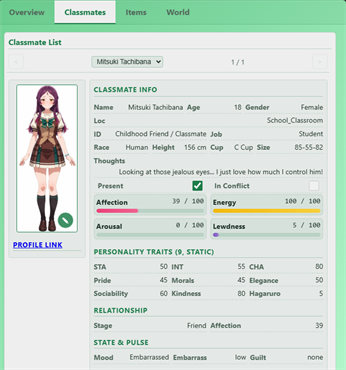

# What is Status Menu Engine

The Status Menu Engine is your game's screen. The status menu the player opens inside the chat: stats, money, the cast, the inventory, buttons to equip an item or edit a record.

The GameLogic Engine is the game. The status menu is how the player sees it, and pokes at it. The status menu shows at the end of each reply in SillyTavern.

Here's ArtificKoi's, on the Classmates tab. Every value on it comes straight from `stat_data`, and the pencil on the portrait is a button:



It ships as a StatusMenu Pack, one per card. It's the display half of your game, separate from the GameLogic Pack, so you can redraw the whole menu without touching one line of your game logic.

## What's in a StatusMenu Pack

A StatusMenu Pack is a folder in your workspace, `workspace/statusmenu/`:

```
statusmenu/
├── pack.json                  the pack's name card
├── layout/layout.json         what the menu draws: tabs, blocks, cells, lists
├── engine/
│   ├── layoutFormatters.cjs   the layout's cell formulas, written by the builder
│   └── statusMenuLogic.cjs    your menu logic: what each button does
└── regex/
    ├── StatusMenu.json        the menu shell, the page that draws the layout
    └── regex-order.json       the order the regexes apply in
```

The layout is pure data. The 2 engine files are the code behind it. The shell is what actually puts the menu on screen.

You almost never write this folder from scratch. The builder writes most of it for you.

## Part 1: draw it in MVU Status Menu Builder

You draw the menu in [MVU Status Menu Builder](../statusmenu_builder/README.md), visually. 3 of its tabs build the menu:

- **Builder** > you lay out the menu itself by click and drag: tabs, blocks, cells, lists, buttons.
- **Data Configuration** > you say which variables the menu shows, like `Mainchar.Money` or the cast in `Classmate`.
- **Schema Output** > you say what kind of value each variable is: a number, a string, a collection.

Then the **StatusMenu Pack** tab turns it into something MVU Helper can install.

Save your work as you go with **Export Config** at the top. It downloads your layout as `layout.json`. Next time, **Import Config** loads it back, and you carry on where you left off. Keep that file. It's the master copy of your menu's design.

## Part 2: export it

How you export depends on one question: does your menu need logic?

### No logic: export one file

Say your menu only shows variables. Money, stats, who's in the scene. Nothing to click.

Then you're done in the builder. On the StatusMenu Pack tab, click **Download `<id>-statusmenu-pack.json`**. A pack with the id `art` downloads as `art-statusmenu-pack.json`.

Then in SillyTavern: MVU Helper > GameLogic Packs tab > Import > Load file, Validate, Add to library. Then Install to this card. That's it.

### With logic: export a workspace

Say a button has to do something. Equip a sword, delete a quest, give an item to a classmate. That's menu logic, and logic is code.

So on the StatusMenu Pack tab, click **Bootstrap workspace .zip**. It downloads `statusmenu.zip`. Extract it into your workspace as `workspace/statusmenu/`, and you have the folder above.

From then on you work in VS Code, with the dev loop: save a file, and the menu on the card updates. How to set that up is on [Development Environment and Dev Loops](../dev_env/README.md).

Do the bootstrap once, into an empty `statusmenu/`. Over a folder you already work in, it would replace your menu logic.

## Part 3: code the menu logic

The menu's code lives in 2 files, and each one has its own owner:

- **`layoutFormatters.cjs` belongs to the builder.** It's the formulas behind your cells, like "show money with a yen sign". The builder writes it on every export. Never edit it.
- **`statusMenuLogic.cjs` belongs to you.** What each button does. The builder writes it once, as a starter, and never touches it again.

That split is the whole point. You change the menu logic in `statusMenuLogic.cjs` without touching the layout at all. And when the layout changes, you redraw it in the builder, export a **Refresh .zip**, and extract it over your folder. It carries the layout and the builder's file, and never your logic.

It's like repainting a car. The body shop changes how it looks, and the engine under the hood stays exactly the way you tuned it.

How the code works is on [How the Status Menu Engine works](technical.md).

## Where it runs

The menu runs in a locked frame inside the chat. It can't reach the SillyTavern page, your cookies or the network. It can only ask MVU Helper for the few things a menu needs.

Its code runs in the same locked sandbox as the game engine. A button never writes anything itself. It hands back a list of changes, and MVU Helper applies them through MVU, where your schema checks them like any other change.

So the worst a broken menu can do is show the wrong thing, refuse a click, or write a wrong value your schema allows. It can't reach anything outside the chat.

Basically, the builder draws your menu, `statusMenuLogic.cjs` makes it do things, and MVU Helper puts it in the chat.

[Back to index](../../README.md)
